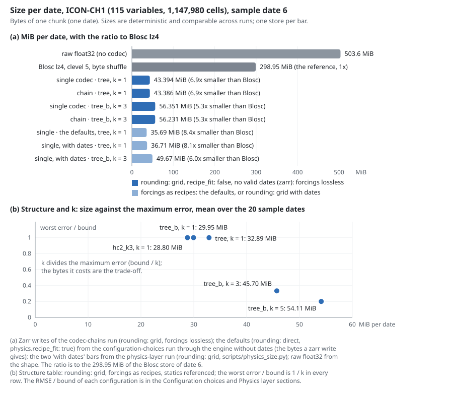
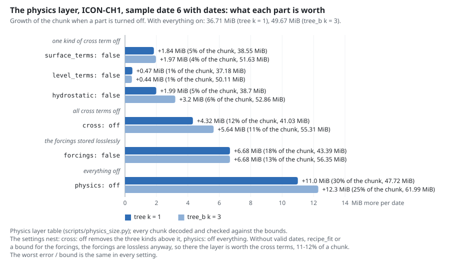
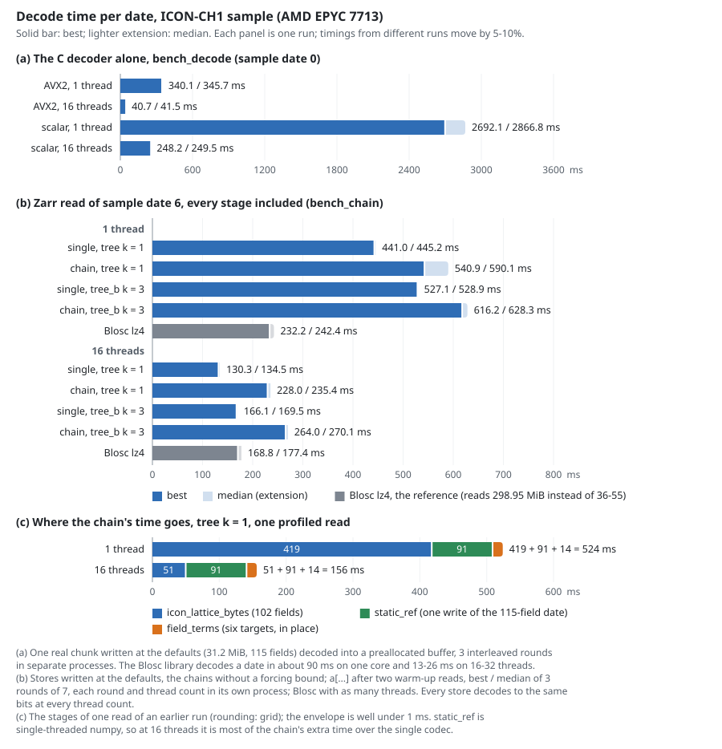
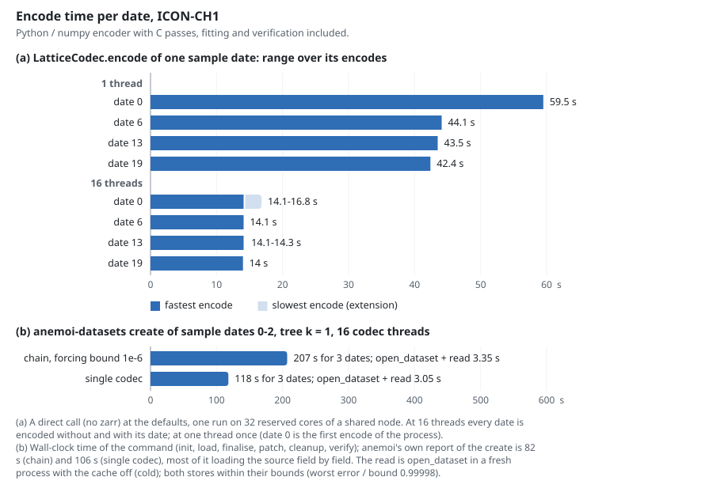

# Benchmarks

Size, error and speed of the package's codecs, measured on one dataset: ICON-CH1, 115 variables per date on
1,147,980 cells, 13 of them static fields, with COSMO variable names (the `icon-ch1` convention). The sizes and
timings quoted in the README and the user guide come from here; the codec and design documents add a few measurements
of their own. Another dataset (other variables, other static fields, another grid) gives other numbers.

## Setup

| item | value |
|---|---|
| CPU | AMD EPYC 7713 (64 cores per socket), 32 cores reserved for every timing not marked indicative; AVX2 kernels unless stated |
| software | gcc 12.3, numpy 2.5.4, zarr-python 3.4.2; for [anemoi-datasets end to end](#anemoi-datasets-end-to-end) Python 3.13 and anemoi-datasets 0.5.50 |
| data | ICON-CH1 sample: 20 dates of an ICON-CH1 anemoi dataset, 115 variables x 1,147,980 cells per date (503.6 MiB raw float32), Zarr format 3; not distributed with the repository ([scripts](../scripts/README.md)) |
| configuration | `tests/data/icon_ch1_sample.json`: variables, bounds (per variable, the smaller of a physical tolerance and 1% of its standard deviation), clips, 13 static fields; `tree`, k = 1, `options.rounding: grid` and `physics.recipe_fit: false` unless stated (the package's defaults are `direct` and `true`, see [Size](#size)) |
| reference | anemoi's default compressor, Blosc lz4 (clevel 5, byte shuffle): 298.5 MiB per date on average over the 20 dates (291-305), 298.95 MiB for sample date 6 |
| units | MiB (2^20 bytes), KiB (2^10 bytes), milliseconds; best and median of the repeats both given |

Timings depend on the machine and its load: the same code moves by 5-10% between runs, so variants are compared
only within one run, and every panel of the figures draws one run. Tables marked **indicative** were timed on a
shared, busy AMD EPYC machine; their ratios between rows are a guide, their absolute values are not. Sizes and
errors do not depend on the machine (the chunk bytes are deterministic for the same package version, configuration
and numpy).

## Reproduce on your machine

The measurements come from the scripts below; [`scripts/README.md`](../scripts/README.md) describes them, their
arguments and which of them need the ICON-CH1 sample. The decode benchmark runs on any Zarr 3 store whose `data` array
was written with the single lattice codec (`icon_lattice_bytes` or `icon_lattice`), for example a store of your own
data written as in the [user guide](user-guide.md#zarr-3-store):

```bash
uv run python scripts/bench/bench_decode.py STORE decode.jsonl --threads 1,16 --isa avx2
uv run python scripts/bench/bench_decode.py STORE decode.jsonl --threads 1,16 --isa scalar --repeats 3
uv run python scripts/bench/summary.py decode.jsonl     # best / median per kernel variant and thread count
```

With the sample (`ANEMOI_DATASETS_CODECS_SAMPLE`):

* **Decode speed**: `scripts/realdata_store.py write OUT.zarr 3` writes a store to run `bench_decode.py` on; it
  decodes one chunk into a preallocated buffer, after a warm-up, N times per thread count, for the AVX2 and the scalar
  variant (`--isa`), and reports best and median per (variant, threads) as JSON lines. Run the rounds in separate
  processes and interleave them.
* **Size and the physics layer**: `scripts/physics_size.py` encodes one sample date with the physics on, off and each
  part off on its own, for a structure and `k`, decodes every chunk and checks it against the bounds, and writes one
  JSON line per setting.
* **Configuration choices**: `anemoi-datasets-codecs lab ledger run ... --dates 0,6,13,19` ([lab](lab.md)).
* **Codec chains**: `scripts/bench/bench_chain.py` writes one sample date through zarr with the single codec, the
  chain of `physics expand` and Blosc lz4, checks the bounds, and times the write and zarr reads at 1 and 16 threads;
  `scripts/anemoi_chain.py` runs `anemoi-datasets create` with the chain and with the single codec and reads both back
  with `open_dataset`.
* **Encode speed**: `scripts/bench/bench_encode.py write OUT.json --threads N`.

The scripts use the sample configuration as it is, so with the package's defaults they measure `rounding: direct`
and `recipe_fit: true`; the rows of this document measured with `rounding: grid` and `recipe_fit: false` need these
two keys in the configuration (for `lab ledger run`: `--set options.rounding=grid --set physics.recipe_fit=false`).
* **Stores end to end**: `scripts/realdata_store.py` writes sample dates to a Zarr 3 store, reads them back in a fresh
  process with only `ANEMOI_DATASETS_CODECS_PATH=<store>` (cache off), with zarr and with anemoi-datasets, and checks
  the bounds, sizes and `anemoi-datasets-codecs check`.

## Grid and structures

The ICON-CH1 grid (bundled as `icon-ch1`):

| item | value |
|---|---|
| lattice image `(H, W)` | 1044 x 1603 |
| grid-file edges validated as lattice neighbours | all 3.44 M |
| lattice file `grids/<sha256>.npz` | 66 KiB |
| finest-level parents with their 4 children consecutive in native order | 96.7% |
| structure steps | `tree` 12 (about 1100 coarsest nodes delta-coded), `tree_b` 16, `hc2_k3` 18 |
| structure build from the lattice | 1.2-2.2 s (then cached on disk) |

## Size

Two configurations of the lattice codec appear in this document, named by the two options in which they differ:

* `rounding: direct`, `recipe_fit: true`: the package's **defaults**. Measured in
  [configuration choices](#configuration-choices) without valid dates (the bytes a zarr write gives): 27.2-35.7 MiB
  per date (mean 31.87 MiB over sample dates 0, 6, 13 and 19), the forcings as recipes; drawn in figure (a) below.
  The timings of [decode speed](#decode-speed), [codec chains](#codec-chains),
  [anemoi-datasets end to end](#anemoi-datasets-end-to-end) and [encode speed](#encode-speed) use it.
* `rounding: grid`, `recipe_fit: false`: every other table and figure, unless a row says otherwise. Without valid
  dates (any zarr write) the forcings are then stored exactly: 31.5-44.8 MiB per date (mean 39.0 MiB over the 20
  sample dates); rows "with dates" give the encoder the valid dates, so the forcings are recipes there.

One ICON-CH1 date, `tree`, k = 1, `rounding: grid`, physics on with `recipe_fit: false`:

| how written | MiB per date | vs Blosc lz4 |
|---|---|---|
| `encode(x, dates=...)`: forcings as recipes | 34-37 (36.71 for date 6) | 8-9x |
| through zarr (no dates: forcings lossless), dates 0-2 | 38.7 | 7.7x |
| through zarr, date 6 | 43.39 | 6.9x |
| Blosc lz4 | 298.5 (date 6: 298.95) | 1x |

Per store, once: the sidecar (the lattice and the 13 static fields, about 1.6 MiB each) is 20.8 MiB; the codec
configuration in the metadata about 4.3 KiB (4368 B as compact JSON for the 115 variables, every option written out;
with the static fields in it as base64 it would be about 28 MiB). Splitting large gather
steps into ranges for multi-threaded decoding costs about 0.1 MiB per date. Every variable was within its bound
(worst error / bound 1.0000 at k = 1).

With `statics: inline` every chunk carries the static fields instead of referencing them (self-contained chunks, no
sidecar). All 20 sample dates through the engine (no valid dates, `tree`, k = 1, `rounding: grid`,
`recipe_fit: false`), range over the dates and mean:

| store form | MiB per date | vs raw float32 |
|---|---|---|
| statics as references (default) | 31.5-44.8 (39.0) | 11.2-16.0x (13.0) |
| `statics: inline` (blosc lz4) | 57.9-71.2 (65.4) | 7.1-8.7x (7.7) |
| Blosc lz4 | 291-305 (298.5) | 1.7x |

The inline form is 26.37 MiB larger on every date (the 13 static arrays, blosc lz4; about 20.7 MiB with the sidecar's
zstd form). Encode and decode times of the two forms were the same within the spread of an indicative run.

Structure and `k`, mean over the 20 sample dates, `rounding: grid`, forcings as recipes, statics referenced (one run;
the error column is the median over the lossy fields):

| structure | k | MiB per date | worst error / bound | median RMSE / standard deviation |
|---|---|---|---|---|
| `tree` | 1 | 32.89 | 1.000 | 0.00344 |
| `tree_b` | 1 | 29.95 | 1.000 | 0.00340 |
| `hc2_k3` | 1 | 28.80 | 1.000 | 0.00340 |
| `tree_b` | 3 | 45.70 | 0.333 | 0.00114 |
| `tree_b` | 5 | 54.11 | 0.200 | 0.00069 |

The worst error is the bound divided by k; the RMSE / bound of each configuration is in [configuration
choices](#configuration-choices) (0.48 with `rounding: grid` and 0.52 with `direct` at k = 1) and
[physics layer](#physics-layer) (0.17 at k = 3).



*(a) MiB per date for sample date 6 with the ratio to Blosc lz4: raw float32, zarr writes of the single codec and
the chain with `rounding: grid` and the forcings stored exactly ([codec chains](#codec-chains)), the defaults (`rounding: direct`,
`recipe_fit: true`) from [configuration choices](#configuration-choices) and the single codec with dates of the
[physics layer](#physics-layer) (`rounding: grid`). (b) The structure table above: bytes against the maximum error.*

## Physics layer

One ICON-CH1 date (sample date 6), with dates, `rounding: grid`, `scripts/physics_size.py`; every chunk decoded and
checked against the bounds.

| setting | `tree`, k = 1 | `tree_b`, k = 3 |
|---|---|---|
| physics on (default switches) | 36.71 MiB | 49.67 MiB |
| `surface_terms: false` | 38.55 (+1.84) | 51.63 (+1.97) |
| `level_terms: false` | 37.18 (+0.47) | 50.11 (+0.44) |
| `hydrostatic: false` | 38.70 (+1.99) | 52.86 (+3.20) |
| `cross: off` (all cross terms) | 41.03 (+4.32, 12% of the chunk) | 55.31 (+5.64, 11%) |
| `forcings: false` (with dates) | 43.39 (+6.68) | 56.35 (+6.68) |
| `physics: off` | 47.72 (+11.0) | 61.99 (+12.3) |



*The table above as the growth of the chunk when a part is turned off, for `tree` k = 1 and `tree_b` k = 3 (sample
date 6 with dates); the settings nest, `cross: off` removes the three kinds above it, `physics: off` everything.*

From the [configuration choices](#configuration-choices) runs: the decode-depth limit (`max_depth: 1`, with the
default `cross: shallow`) costs 65 KiB (0.15%) on date 6 against the unlimited plan; the below-ground terms
(`below_ground: true`, off by default) save 1.34-1.81 MiB per date with `tree` on four dates.

The forcings count only when the encoder gets the valid dates, or without them with `physics.recipe_fit` (single codec,
the default) or a bound for the forcings (`physics expand --forcing-bound`); with none of these a store written through
zarr stores them losslessly, and there the layer is worth the cross terms, 11-12% of a chunk. The worst error / bound is
the same in every setting; the mean RMSE / bound moves in the fourth digit at k = 1 (0.4805 with the terms, 0.4813
without; residual-domain reconstruction rounds around the prediction) and not at all at k = 3 (0.1656).

## Configuration choices

Sample dates 0, 6, 13 and 19 (31.5-44.8 MiB in the first row), `tests/data/icon_ch1_sample.json` with `rounding: grid`
and `recipe_fit: false` and one change at a time, encoded through the engine without valid dates (the bytes a zarr write
gives), `lab ledger run ... --dates 0,6,13,19`. Bytes of the chunk; "lossy" is the 97 lossy fields only; RMSE / bound
the mean over them. Every variable was within its bound (worst error / bound 0.99999 in every run).

| change | MiB per date (mean) | chunk vs first row | lossy fields | RMSE / bound |
|---|---|---|---|---|
| none (`tree`, `recon_bits` 3, `rounding: grid`, `recipe_fit: false`) | 38.70 | | | 0.479 |
| forcings with a bound of 1e-6 | 32.94 | -11.5 to -18.2% | | 0.479 |
| `physics.recipe_fit: true` | 32.86 | -11.7 to -18.4% | | 0.479 |
| `structure: tree_b` | 35.72 | -6.9 to -8.3% | -9.1% | 0.476 |
| `structure: hc2_k3` | 34.44 | -10.1 to -12.0% | -13.0% | 0.475 |
| `physics.below_ground: true` | 37.20 | -3.1 to -5.4% | -4.6% | 0.475 |
| `recon_bits: 5` | 38.06 | -1.6 to -1.8% | -2.0% | 0.506 |
| `recon_bits: 8` | 37.86 | -1.9 to -2.3% | -2.6% | 0.513 |
| `rounding: direct` | 37.71 | -2.3 to -2.8% | -3.0% | 0.517 |
| `cross: on`, `max_depth: null` | 38.09 | -1.2 to -2.1% | -1.9% | 0.478 |
| **`tree` + `direct` + `recipe_fit`** (the defaults) | 31.87 | -14.4 to -20.9% | -3.0% | 0.517 |
| `tree` + `direct` + `below_ground` + `recipe_fit` | 30.40 | -18.2 to -24.4% | -7.5% | 0.513 |
| `tree_b` + `direct` + `below_ground` + `recipe_fit` | 27.54 | -26.0 to -31.9% | -16.2% | 0.507 |
| `hc2_k3` + `direct` + `below_ground` + `recipe_fit` | 26.38 | -29.3 to -34.9% | -19.7% | 0.507 |

* **The defaults** are the two changes that cost no decode time: `rounding: direct` (same decoder) and
  `recipe_fit: true` (three recipes instead of three lossless fields): 17.6% smaller than the first row on average,
  32,740,568 / 37,427,804 / 34,951,216 / 28,566,984 B (31.22 / 35.69 / 33.33 / 27.24 MiB) on the four dates, at the
  same maximum error. The rest of the gain in this table costs decode time ([decode speed](#decode-speed)): `hc2_k3`
  about 38% on one thread through the generic gather kernel, the below-ground terms about 25% at 16 threads through
  the critical path. They stay experimental configuration choices until a kernel for `hc2_k3` has landed or been
  dropped ([goals](goals.md#towards-10)).
* **Forcings.** Through zarr the three forcings are 11-18% of a chunk (16 bits per value; one fewer at night, when
  the insolation is a constant field). `recipe_fit` stores them as recipes (64 bytes each, every cell within the
  recipe bound 1e-6: 0 patched cells on all 20 sample dates); a 1e-6 bound codes them at about 0.6 bits per value
  and works in a chain too.
* **Structures.** `hc2_k3` is smaller on every lossy field but `FI_500` (+15%) and `OMEGA_50`; `tree_b` loses on
  `FI_500` and `OMEGA_50` too. Their decode speed against `tree` has been timed only indicatively (see
  [decode speed](#decode-speed)).
* **Below-ground terms.** `U/V_1000` -69%, `FI_1000` -67%, `FI_925` -52% (the field that spent 40% of its bytes on
  escapes), `OMEGA_1000`, `FI_850`, `T_1000`; `U/V_10M` grow by 124-130% because they lose their `U/V_1000` source to
  avoid a cycle with the mask terms (the winds are still a net gain). Single codec only: in a chain the lattice codec
  sees the residual of `PS` ([user guide](user-guide.md#writing-the-configurations-physics-expand)). The coefficients
  are float64 least squares per chunk, so these bytes depend on the numpy version.
* **Quantiser.** `recon_bits` m with `rounding: grid` shrinks the step by `1 + 2^-m` (11% at m 3); m 5 and
  m 8 buy back part of it, m 8 with int32 values on high-rate fields and small losses where those details feed cross
  terms (`U/V_10M`, `FI_1000`). `rounding: direct` removes the penalty at m 3 with int16 values and is the smallest;
  all three raise the RMSE from 0.48 to 0.51-0.52 of the bound, at the same maximum error.
* **Geopotential terms.** `cross: on` without the depth limit (decode dependency depth 8 instead of 2) gains on
  `FI_500` (-62%) and the upper levels and loses on `FI_600` (+84%, predicted from `FI_850` instead of the 500 hPa
  star) and `FI_400` (+23%). Plans given by hand (`lab`-style, not in the package): the upper levels each from the
  two levels below with the star kept for 600 and 700 hPa, -1.78% (depth 9); every level from the two below,
  -1.79% (depth 13): 0.2% beyond `cross: on`, not worth a new mode. On the Alpine mini grid the same plans ranked
  differently (below-ground geopotential); the full grid decides.
* **The chain** (`physics expand`, through zarr): 39.57 / 43.38 / 39.07 / 33.34 MiB on the four dates with `rounding:
  grid` and the forcings stored exactly (the single codec within 0.3%); with `hc2_k3`, `rounding: direct` and
  `--forcing-bound 1e-6` 27.39 / 31.37 / 29.12 / 24.70 MiB, -25.5 to -30.8%, 4-9% above the single codec with the
  below-ground terms.

## Decode speed

One real CH1 chunk (date 0 written through zarr with the defaults, 31.2 MiB, 115 fields, the forcings as recipes)
decoded into a preallocated buffer by `scripts/bench/bench_decode.py`, 3 interleaved rounds in separate processes (9
decodes per round with AVX2, 3 with the scalar kernels); best over the rounds, median of the rounds' medians:

| variant | threads | best ms | median ms |
|---|---|---|---|
| AVX2 | 1 | 340.1 | 345.7 |
| AVX2 | 16 | 40.7 | 41.5 |
| scalar | 1 | 2692.1 | 2866.8 (8.3x the AVX2 median) |
| scalar | 16 | 248.2 | 249.5 (6.0x the AVX2 median) |

In short: 0.34 s on one core, 41 ms on 16 with AVX2; the scalar variant 2.7 s / 0.25 s (drawn next to the zarr reads
in the [decode figure](#codec-chains) of the codec chains section). Every variant and thread count decoded the same
bits. An earlier run on a date-6 chunk with `rounding: grid` (36.7 MiB) gave 353-368 ms and 38-39 ms: the rounding
changes the bytes, not the decoder. For scale, the Blosc library decodes date 6 (298.95 MiB) in about 90 ms on one
core and 13-26 ms on 16-32 threads, depending on the run (a zarr read of the Blosc store, with zarr's own work, takes
232 ms on one thread: [codec chains](#codec-chains)). The scalar variant is the fallback on CPUs without AVX2 and
decodes bit-identically. The AVX2 rANS stage alone takes about 60 ms on one core for the ~111 M symbols of a date.
The `icon_lattice_bytes` adapter decodes straight into zarr's output buffer, so a zarr read is as fast with it as
with `icon_lattice`.

**Indicative** (`OMP_WAIT_POLICY=active`, best of 15 decodes of sample date 6 into a preallocated buffer, one
process): the configuration choices of [the section above](#configuration-choices); each row names what differs
from `tree`, `rounding: grid`, `recipe_fit: false`.

| chunk (date 6) | MiB | 1 thread ms | 16 threads ms |
|---|---|---|---|
| none (`tree`, forcings lossless) | 43.39 | 383 | 35 |
| `tree` + `recipe_fit` | 36.72 | 388 | 32 |
| `tree`, `recon_bits` 8 | 42.53 | 380 | 35 |
| `tree_b` | 39.96 | 447 | 41 |
| `hc2_k3` | 38.62 | 530 | 44 |
| `tree`, `cross: on`, `max_depth: null` | 42.72 | 433 | 50 |
| `hc2_k3` + `direct` + `recipe_fit` | 31.19 | 522 | 40 |
| `hc2_k3` + `direct` + `below_ground` + `recipe_fit` | 29.75 | 558 | 50 |
| the same + `cross: on`, `max_depth: null` | 29.28 | 564 | 97 |

In this run `tree_b` is about 17% and `hc2_k3` about 38% slower than `tree` on one thread (the generic gather kernel
for the up-corners and for `hc2_k3`); the below-ground terms add about 7% on one thread and 25% on 16; the unlimited
geopotential chain (dependency depth 8) costs little on one thread and doubles the 16-thread time (its critical
path). Because these timings are indicative, the choices that cost decode time are not defaults.

Loader replica (one 128-CPU machine, 4 ranks x 8 DataLoader workers, one codec thread per worker, cold reads, 192
dates): `tree` k = 1 reached 6.58 samples/s and `tree_b` k = 3 5.81 against 5.62 for Blosc lz4 (+17% and +3%); the
per-chunk decode is slower than Blosc's, but the smaller reads (5-9x fewer bytes than Blosc lz4, depending on the
structure, k and the forcings) more than pay for it.

## Codec chains

`scripts/bench/bench_chain.py`, sample date 6, the defaults, written through zarr (`a[:] = x`: no valid dates), each
store registered so that its sidecar holds what it references; the chain is the output of `physics expand` for the
sample configuration (the six orography terms on FIS in `field_terms`, margin `2^-6` from the sample's statistics; the
13 static fields in `static_ref`; 102 fields in the lattice codec); every variable read back within its bound, the
forcings within the recipe bound (single codec) or the forcing bound, the others bit for bit.

| store | `tree`, k = 1 | `tree_b`, k = 3 |
|---|---|---|
| single codec (`icon_lattice_bytes`, statics as STATIC_REF, forcings as recipes) | 35.694 MiB | 48.267 MiB |
| chain `[field_terms, static_ref, icon_lattice_bytes]` of `physics expand --forcing-bound 1e-6` | 35.776 MiB (+0.23%) | not measured |
| chain of `physics expand` without a forcing bound (forcings lossless) | 42.363 MiB (+18.7%) | 54.836 MiB (+13.6%) |
| Blosc lz4 (clevel 5, byte shuffle) | 298.95 MiB | 298.95 MiB |

In a chain the lattice codec has no latitude / longitude inputs for recipes, so `recipe_fit` does not apply there: a
chain needs `--forcing-bound` to match the single codec, and without it stores the three forcings losslessly (6.6 MiB
of this date). With the forcings lossless in both (`rounding: grid`, `recipe_fit: false`) the chain was 0.02% / 0.21%
smaller than the single codec (43.386 against 43.394 MiB, 56.231 against 56.351 MiB). The sidecar is the same for
every store (lattice and 13 static fields, 20.8 MiB); the configurations take 4.3 KiB (single, 4368 B) and 7.1 KiB
(the three codecs, 7267 B; 7338 B with the forcing bound) in `zarr.json`.

Write time of the date (zarr write, encode and verification included, 16 threads; two runs for `tree` k = 1, one for
`tree_b` k = 3, on a node shared with the other benchmark jobs): single 25.9 s and 45.0 s, chain 46.7 s and 32.6 s,
chain with the forcing bound 32.7 s; `tree_b` k = 3 single 30.2 s, chain 50.0 s. The spread between runs is larger
than the difference between the stores.

Zarr read of the date (`a[...]`, decode and every stage, after two warm-up reads; best / median of 3 rounds of 7,
each round and thread count in its own process; Blosc with as many threads):

| store | 1 thread best / median ms | 16 threads best / median ms |
|---|---|---|
| single, `tree` k = 1 | 441.0 / 445.2 | 130.3 / 134.5 |
| chain, `tree` k = 1 | 540.9 / 590.1 (+23%) | 228.0 / 235.4 (+98 ms) |
| single, `tree_b` k = 3 | 527.1 / 528.9 | 166.1 / 169.5 |
| chain, `tree_b` k = 3 | 616.2 / 628.3 (+17%) | 264.0 / 270.1 (+98 ms) |
| Blosc lz4 | 232.2 / 242.4 | 168.8 / 177.4 |

A second run with the chain of `--forcing-bound 1e-6` (`tree` k = 1): single 450.8 / 463.0 ms and 130.7 / 134.5 ms,
chain without a forcing bound 530.6 / 542.1 ms (+18%) and 226.4 / 232.8 ms, chain with the forcing bound 535.9 /
544.9 ms and 225.9 / 232.5 ms. The forcing bound moves three fields from lossless to lossy and does not change the
read time.



*Decode time per date, best (solid) and median (lighter): (a) the C decoder alone from the
[decode speed](#decode-speed) table, (b) the zarr read table above, (c) the chain's stages of one profiled read. One
run per panel; the panels are not on one axis.*

Every thread count decoded each store to the same bits. Where the time goes in the chain (`tree` k = 1, one profiled
read per thread count, an earlier run with `rounding: grid`): the lattice codec 419 ms at 1 thread / 51 ms at 16 (102
fields instead of 115), `static_ref` 91 ms (one write of the whole 115-field date: the 102 decoded fields to their
places and the 13 static arrays, single-threaded numpy), `field_terms` 14 ms (in place, six targets), the envelope
well under 1 ms. The `static_ref` copy is the price of the stage boundary; at 16 threads it is most of the
difference. If the one-thread figure carries over to a training loader (one codec thread per DataLoader worker), the
chain costs about 20% more decode time per date than the single codec (18-23% in the two runs); the loader replica
([decode speed](#decode-speed)) was not run with the chain.

## anemoi-datasets end to end

`scripts/anemoi_chain.py`, 16 codec threads, Python 3.13, zarr 3.4.2, anemoi-datasets 0.5.50. `anemoi-datasets create`
(init, load, finalise, patch, cleanup, verify) from the sample as an `anemoi_dataset` source, sample dates 0-2
(2000-01-01T00 to 02), `tree` k = 1, the defaults, with the `output` section of `physics expand --variables <sample>
--forcing-bound 1e-6` and, for comparison, the single `icon_lattice_bytes` codec of the same configuration;
`ANEMOI_DATASETS_CODECS_PATH=<target>` for the build. Then `open_dataset` in a fresh process with only
`ANEMOI_DATASETS_CODECS_PATH=<store>` and the cache off read the three dates and compared them with the source, and
`anemoi-datasets-codecs check` ran on each store.

| store | MiB per date | create (3 dates) | `open_dataset` + read of 3 dates, cold | worst error / bound | `check` |
|---|---|---|---|---|---|
| chain, `--forcing-bound 1e-6` | 31.505 | 207 s | 3.35 s | 0.99998 | no problems (3 chunks) |
| single codec | 31.283 | 118 s | 3.05 s | 0.99998 | no problems (3 chunks) |

The chain is 0.71% larger than the single codec on these three dates (0.23% on date 6, above): the lattice codec's
terms on FIS are worth date-dependent amounts that the six `field_terms` terms do not always match, and the forcings
cost a little more under a bound than as recipes. Without `--forcing-bound` the chain stores the forcings losslessly:
37.821 MiB per date in a run of the same three dates, 20.9% above the single codec. anemoi wrote the variables sorted
by name, the order `physics expand` took from the sample store; every variable came back within its bound, the
forcings within the recipe bound (single codec) or the forcing bound (chain), every other lossless one bit-identical.
Chunks were one whole date (`chunking: {dates: 1, ensembles: 1, values: 1147980}` in the generated section). The
create times are wall-clock times of the command, one run each: anemoi's own report of the create was 82 s (chain)
and 106 s (single codec), most of it loading the source field by field, the rest is start-up; a first build with
cold file caches took 533 s. The codec's part is the encode of three dates
([encode speed](#encode-speed)).

## Encode speed

`LatticeCodec.encode` of a sample date at the defaults, direct call (no zarr), Python / numpy with C passes, fitting
and verification included; `scripts/bench/bench_encode.py`, one run on 32 reserved cores of a node shared with other
jobs. At 16 threads every date was encoded twice, without dates (as any zarr write) and with the sample's date; at
one thread once, without dates.

| threads | date 0 | date 6 | date 13 | date 19 |
|---|---|---|---|---|
| 1 | 59.5 s (first encode of the process) | 44.1 s | 43.5 s | 42.4 s |
| 16 | 14.1-16.8 s | 14.1 s | 14.1-14.3 s | 14.0 s |

At one thread the least-squares solves are about half of the time (the fit is the algorithm); at 16 threads the
cross-term wave (48 of the 97 lossy fields, each with 2-4 extra fits per step) sets the wall time. The fits call
numpy's own LAPACK `dgelsd` through ctypes without holding the GIL, with BLAS limited to one thread (a BLAS thread
per core on these many small problems is slower than one).



*(a) The encode table above (at 16 threads the range over the two encodes of a date); (b) `anemoi-datasets create`
of three dates from the [end-to-end](#anemoi-datasets-end-to-end) run, wall-clock time of the command.*
