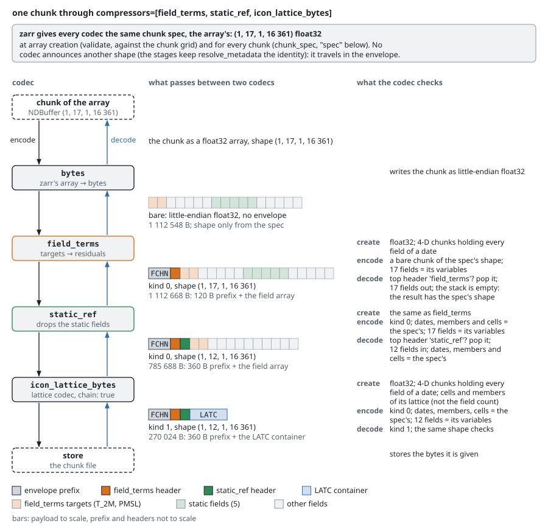
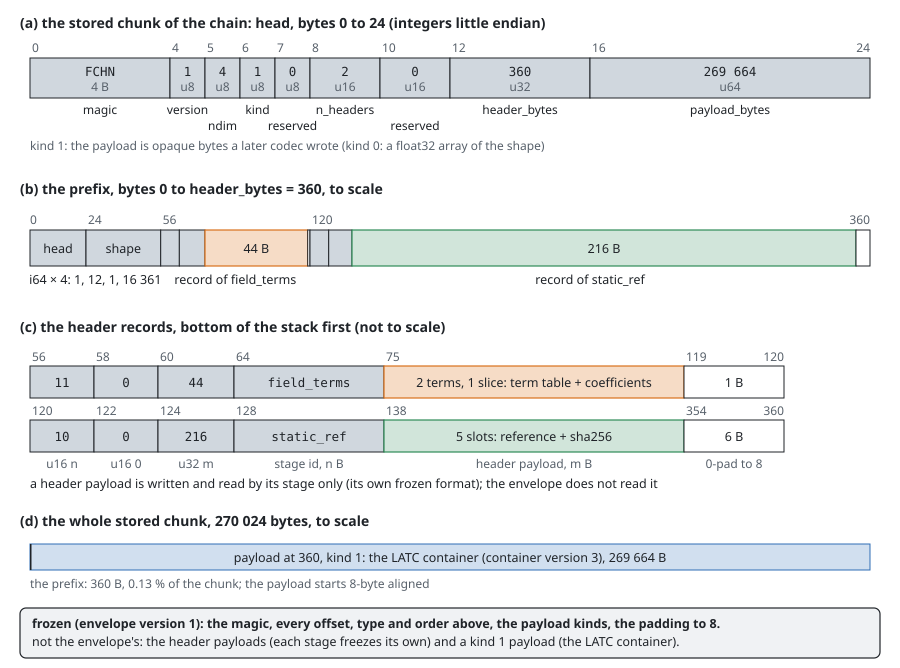
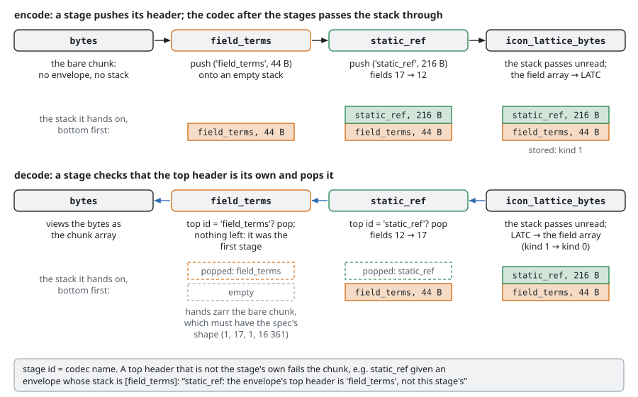
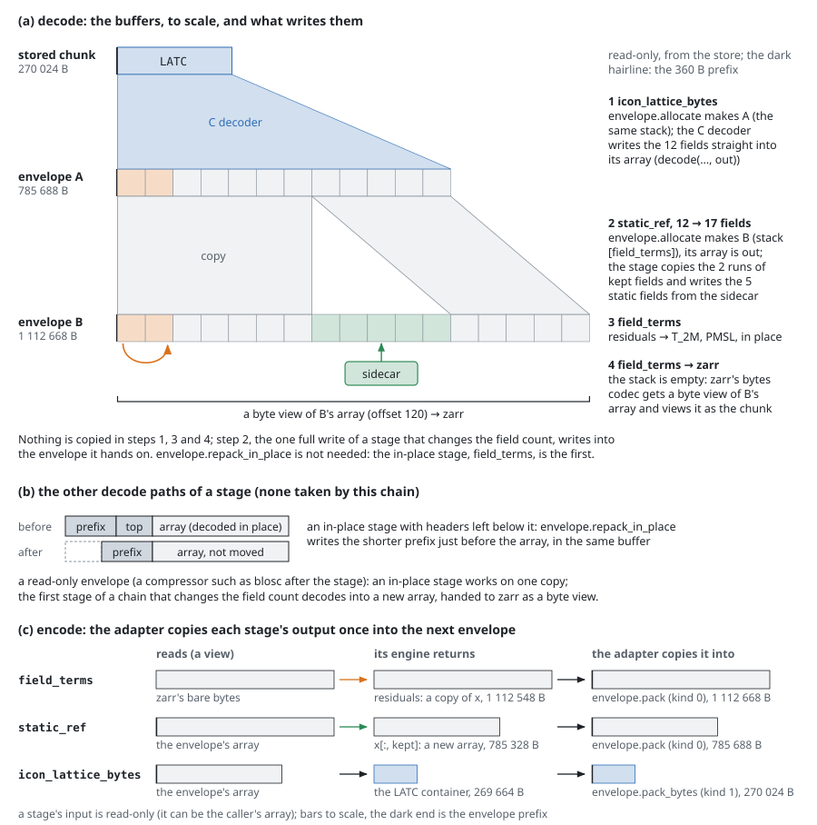

# The chain envelope (`FCHN`)

The in-band framing of a codec chain: how a field stage hands the next codec its field array together with the
per-chunk metadata of every stage before it. The reference implementation is `anemoi_datasets_codecs/envelope.py`;
the adapters that use it are in `anemoi_datasets_codecs/zarr3.py`
([design.md](../design.md#field-stages-and-codec-chains)).

Contents: [Why it exists](#why-it-exists) · [Layout (envelope version 1)](#layout-envelope-version-1) ·
[Recognising an envelope](#recognising-an-envelope) · [Where envelopes appear](#where-envelopes-appear) ·
[Compatibility promise](#compatibility-promise)

## Why it exists

A bytes-to-bytes codec in zarr gets the bytes of the codec before it and nothing else. A field stage changes the
chunk (drops fields, replaces fields by residuals) and must leave the decoder what it needs (a fitted coefficient, a
sha), and the codecs after it must know the shape of what they receive: zarr validates every codec against the
array's original chunk grid and does not tell a bytes-to-bytes codec the shape the codecs before it leave. The
envelope carries both: the shape of the field array and a stack of headers, one per stage, bottom first. A stage
pushes its header on encode and pops it on decode; every other codec passes the stack through unread.

*One chunk of the synthetic test data (`tests/conftest.py`) through `compressors=[field_terms, static_ref,
icon_lattice_bytes]`: the buffer between two codecs (the same on encode and decode), the chunk spec zarr passes to
every codec, and what each codec checks at array creation and per chunk.*

## Layout (envelope version 1)

All integers are little endian.

| offset | type | content |
|---|---|---|
| 0 | 4 bytes | magic `FCHN` |
| 4 | u8 | envelope version = 1 |
| 5 | u8 | `ndim` (1..32) |
| 6 | u8 | payload kind: 0 float32 array, 1 opaque bytes |
| 7 | u8 | 0 |
| 8 | u16 | `n_headers` |
| 10 | u16 | 0 |
| 12 | u32 | `header_bytes`: offset of the payload, a multiple of 8 |
| 16 | u64 | `payload_bytes` |
| 24 | i64 x `ndim` | shape of the field array, C order: `(dates, fields, ensembles, cells)` for field stages |
| .. | `n_headers` records | the header stack, bottom (first stage in encode order) first |
| `header_bytes` | `payload_bytes` bytes | the payload |

A header record:

| offset | type | content |
|---|---|---|
| 0 | u16 | `n`: bytes of the stage id |
| 2 | u16 | 0 |
| 4 | u32 | `m`: bytes of the header payload |
| 8 | `n` bytes | stage id, printable ASCII: the Zarr codec name of the stage that wrote it |
| 8 + `n` | `m` bytes | header payload, written and read by that stage only (its format is the stage's) |
| .. | | zero padding to a multiple of 8 |

The payload:

* **kind 0**: the little-endian float32 field array of the envelope's shape, `prod(shape) x 4` bytes. This is what
  travels between field stages.
* **kind 1**: the bytes a later codec wrote for that array, opaque to the envelope: the `icon_lattice` container
  (magic `LATC`, [icon_lattice.md](icon_lattice.md#chunk-format-container-version-3)) when `icon_lattice_bytes` with
  `chain: true` closes the chain. Decoding gives a kind 0 envelope with the same shape and stack back.

The payload starts 8-byte aligned relative to the start of the envelope, so readers view the array without copying
it.

*The stored chunk of that chain as `envelope.py` writes it: (a) the head, (b) the prefix to scale, (c) the two header
records, (d) the whole chunk. The offsets and sizes are those of the run.*

## Recognising an envelope

A buffer is an envelope only when all of these hold: magic `FCHN`, version 1, payload kind 0 or 1, every reserved field
zero, `ndim` in 1..32 and non-negative dimensions, non-empty printable ASCII stage ids, the records ending exactly at
`header_bytes`, `header_bytes + payload_bytes` equal to the buffer length, and for kind 0
`payload_bytes = prod(shape) x 4`. Anything else is a bare buffer: the plain little-endian float32 chunk the `bytes`
codec writes, of the chunk's shape, with no headers. (A float32 chunk whose first value happens to have the bits of
`FCHN`, about 8.4e8, is therefore still read as a bare chunk.)

## Where envelopes appear

* Between the codecs of a chain (in memory) and, as the stored chunk, when the chain ends in a codec that keeps it:
  `icon_lattice_bytes` with `chain: true` stores `envelope(shape, headers, LATC container)`; a generic compressor
  (Blosc) after the stages stores its compression of a kind 0 envelope.
* Never without a field stage: a codec used alone, or `icon_lattice_bytes` with `chain: true` on a bare input, writes
  bare bytes (for `icon_lattice_bytes`, exactly the container it writes without the key).
* On decode, the stage that pops the last header (the first stage of the chain) hands zarr the bare float32 chunk,
  which must have exactly the chunk's shape.

*The header stack of that chain: each stage pushes its header on encode; on decode it checks that the top header has
its codec name and pops it, and the first stage, left with an empty stack, hands zarr the bare chunk.*

In memory a decode writes every buffer once: `envelope.allocate` lets a codec decode straight into the envelope it
hands on, `envelope.repack_in_place` gives an envelope a shorter stack without moving its array, and the first stage
hands zarr a view of the array. On encode `envelope.pack` copies a stage's output once
([design.md](../design.md#field-stages-and-codec-chains), "Copies").

*The buffers of that chain, to scale: (a) on decode the lattice codec and `static_ref` write into the envelope they
hand on, `field_terms` works in place and hands zarr a view; (b) the paths this chain does not take; (c) on encode,
one copy per codec into the next envelope.*

## Compatibility promise

The package's promise, with what changes at 1.0, is in [goals.md](../goals.md#compatibility-promise). For the envelope:

1. **Envelope version 1 is frozen.** Its layout never changes under this version number: every envelope with magic
   `FCHN` and version 1 written by any release of this package reads identically with every later release
   (`tests/test_envelope.py` pins the bytes of a fixed envelope of each payload kind). A change of the layout gets a new
   version; readers keep reading version 1.
2. **Header payloads belong to their stages.** The envelope does not interpret them; each stage's format document
   freezes its own header, under the stage's codec name (the stage id), which never changes.
3. **The magic is format-level.** `FCHN` (envelope) and `LATC` (lattice container) tell the two apart at offset 0;
   neither changes.
