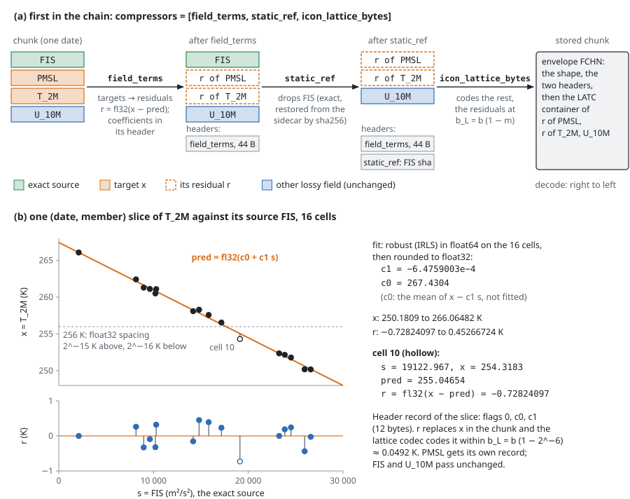
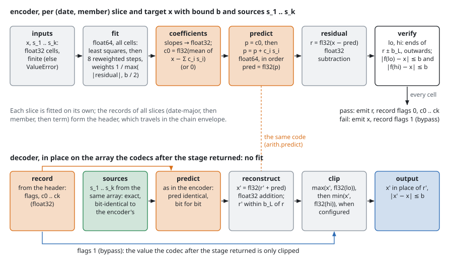
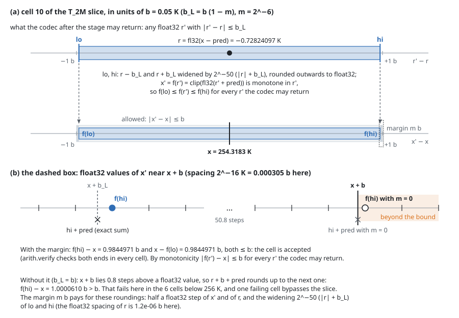
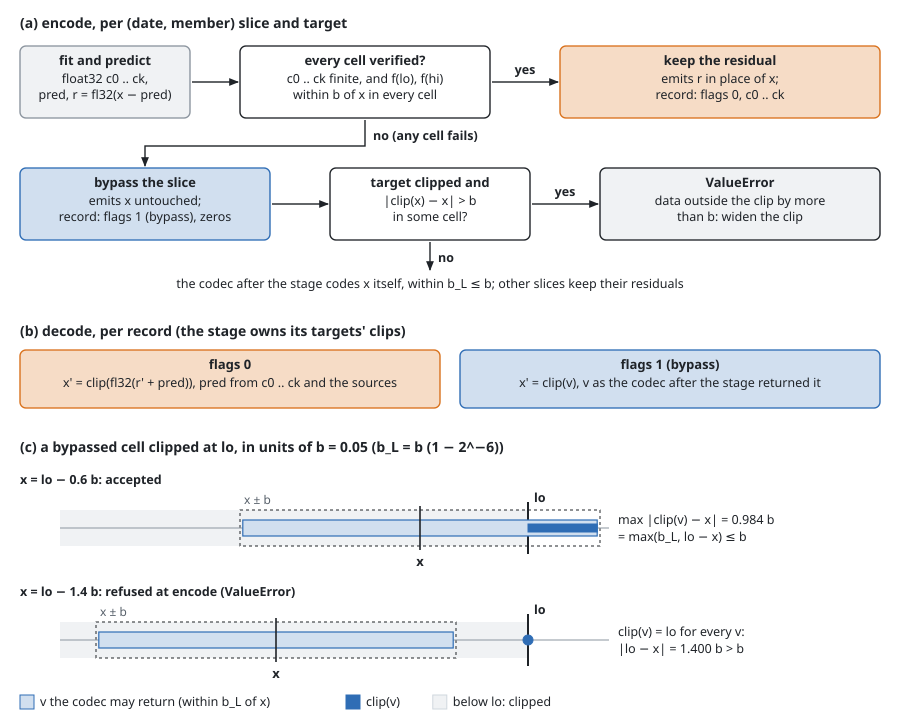
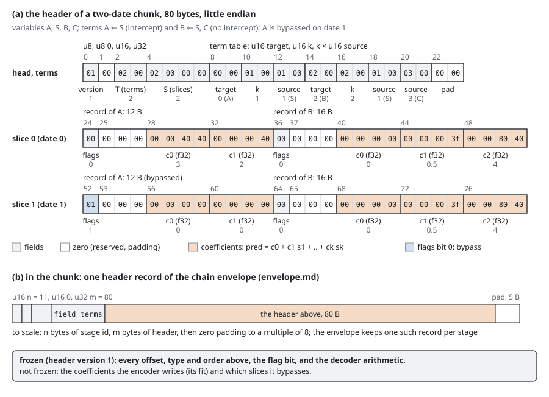

# The field-terms stage (`field_terms`)

A field stage ([design.md](../design.md#field-stages-and-codec-chains)) that replaces lossy *target* fields by their
residuals against a per-chunk robust linear fit on exact *source* fields, ahead of an error-bounded codec in a chain:
`compressors=[field_terms, ..., icon_lattice_bytes]`. Its use is the orography terms the lattice codec loses when the
static fields leave it: mean-sea-level pressure, surface pressure, the 1000 hPa geopotential, 2 m temperature and
dew point and skin temperature all carry a part that is linear in the surface geopotential `FIS`. The stage is
grid-agnostic: it needs the chunk's field array and nothing else. The reference implementation is
`anemoi_datasets_codecs/field_terms/` (`stage.py` the engine, `arith.py` the arithmetic, `header.py` the header).

Contents: [Configuration](#configuration) · [Encode](#encode) · [Decode](#decode) ·
[The error bound](#the-error-bound) · [The codec after the stage](#the-codec-after-the-stage) ·
[Header (version 1)](#header-version-1) · [Compatibility promise](#compatibility-promise)



*(a) `field_terms` comes first in the chain: it replaces each target by its residual and keeps the coefficients in its
header; `static_ref` then drops the static fields and the lattice codec codes the rest. (b) One synthetic (date,
member) slice of T_2M against FIS, computed with the stage: the fitted prediction and the residual that replaces `x`.*

## Configuration

```yaml
variables: [FI_1000, FIS, PMSL, PS, ...]   # the fields the stage receives, in chunk order
terms:                                     # target -> its exact sources (exact names)
  PMSL: [FIS]
  FI_1000: {sources: [FIS], intercept: true}
bounds: {PMSL: 2.0, "FI_.*": 2.0, ...}     # max abs error b, names or regular expressions (as icon_lattice)
clip: {}                                   # optional [lo, hi] of decoded targets (targets only)
margin: 0.015625                           # m: the codec after the stage codes a target within b_L = b (1 - m)
intercept: true                            # default of the terms' intercept
```

Bounds and clips are matched exactly as in the lattice configuration (exact name first, else the first regular
expression that matches the whole name; every key must match a variable; a value may be `{max_error, clip}`), so one
`bounds` mapping serves both codecs. The stage uses the bounds of its targets and checks that its sources have none.

Checks at configuration time, each with an error that names the term:

* every target is a variable with a bound (a lossless field gains nothing);
* every source is a variable, is not the target, appears once, and is exact: no bound, not a target of the stage
  (targets are within their bound, not exact), not a forcing recipe of the lattice codec (`cos_local_time`,
  `sin_local_time`, `insolation`: the lattice evaluates them within `recipe_bound`, not exactly); at most 16 sources;
* clips apply to targets only and have `lo <= hi`;
* `margin` in `[0, 1)`, `intercept` true or false, no unknown keys.

`get_config()` writes the canonical form: `variables`, `terms` as `{target: {sources, intercept}}` in variable order,
`bounds` of the targets, `clip` of the targets (when any) and `margin`. `FieldTerms.lattice_bounds` gives `b_L` per
target.

**Defaults, as measured.** The defaults come from measurements on ICON-CH1 (`tree` k = 1 and `tree_b` k = 3): one `FIS`
coefficient per target and chunk, fitted robustly on the values, with an intercept (the mean), for the six targets PMSL,
FI_1000, T_2M, PS, SKT and TD_2M. With the static fields out of the lattice codec, that recovers what the lattice
codec's own `FIS` terms were worth: on sample date 6 the chain is 0.02% (`tree` k = 1) and 0.21% (`tree_b` k = 3)
smaller than the single codec ([benchmarks](../benchmarks.md#codec-chains)); a plain least-squares fit instead of the
robust one cost about 1%. The float32 margins `b'/b` the targets needed there were 0.9917 to 0.9987, so the default
`margin` is `2^-6` (`b_L / b = 0.984375`), about twice the largest margin needed there, and a power of two, so that `b
(1 - m)` is exact for a bound with a short binary expansion such as 2.0 (for 0.05 it is the rounded float64 product, the
value both configurations carry).

## Encode

Per (date, member) slice and per target `x` with bound `b` and sources `s_1 .. s_k`, all float32:

1. **Finite.** Targets and sources must be finite in every cell (else `ValueError`, naming the variable and the date
   offset; a NaN would give NaN coefficients and a misleading error later).
2. **Fit.** `x ~ c0 + sum c_i s_i` in float64 on all cells: least squares, then 8 reweighted least-squares steps with
   weights `1 / max(|residual|, b / 2)` (IRLS, close to an L1 fit: the residual's cost follows `|r|`, least squares
   chases the tails). The small normal equations are solved centred. The slopes are rounded to float32; with
   intercept `c0` is the float32 rounding of the mean of `x - sum c_i s_i` (rounded slopes, float64), without it 0.
   The fit is the encoder's business: only the stored coefficients matter to the decoder.
3. **Prediction** from the stored coefficients: `p = c0`, then `p = p + c_i * s_i` for `i = 1 .. k` in configured
   order, each a float64 operation (no BLAS, no fused multiply-add), then `pred = fl32(p)`.
4. **Residual** `r = fl32(x - pred)` (a float32 subtraction, i.e. the exact difference rounded to nearest).
5. **Verification** (below). When it passes, the target's slice is replaced by `r` and the record holds the
   coefficients; when it fails (or a coefficient is not finite) the slice is left untouched and the record is flagged
   *bypass*. A bypassed slice of a target with a clip must satisfy `|clip(x) - x| <= b` in every cell (else
   `ValueError`: the data lie outside the clip by more than the bound, see [Bypass](#the-error-bound)).

The output array has the same fields as the input; non-target fields pass through unchanged.

## Decode

In place on the array the codecs after the stage restored: for every slice and every target whose record is not
bypassed, `pred` as in step 3 from the sources in the same array, then `x' = clip(fl32(r' + pred))` with a float32
addition, then `max(x', fl32(lo))` and `min(x', fl32(hi))` when the target has a clip (as the lattice codec clips). A
float32 addition rounds the exact sum to nearest, which equals rounding the float64 sum (float64 has more than
`2 x 24 + 2` bits, so double rounding is innocuous). Targets are never sources, so the terms are independent and their
order does not matter. A bypassed slice is the value `x'` the codecs after the stage returned, clipped the same way
(`max(x', fl32(lo))`, then `min(x', fl32(hi))`): the stage owns its targets' clips, the codec after it does not clip
them.



*One target slice: the encoder fits, rounds the coefficients to float32, predicts, forms the residual and verifies every
cell; the decoder takes the coefficients from the header and repeats only the prediction, the addition and the clip, in
place.*

## The error bound

**Claim.** If every source reaches the decoder bit-identically and the codec after the stage returns, for every cell
of a target, a float32 `r'` with `|r' - r| <= b_L` (as a real number, or as the float64 comparison of float32 values
the lattice codec makes), every decoded target value is within `b` of the original: `|x' - x| <= b`, evaluated as the
float64 comparison of float32 values that the package uses everywhere.

**Argument, per cell.**

1. `pred` is identical at encode and decode: same float32 coefficients (stored), same exact sources, same float64
   operations in the same order, same rounding. This is why sources must be exact.
2. `f(v) = clip(fl32(v + pred))` is monotone non-decreasing in `v`: a float32 addition with a fixed operand,
   rounding to nearest and clipping are each monotone.
3. The verified interval. Every accepted `r'` satisfies `r - b_L (1 + 2^-53) <= r' <= r + b_L (1 + 2^-53)` (a float64
   comparison accepts at most a relative `2^-53` more). The encoder computes the ends `r -+ b_L` in float64, widens
   them by `2^-50 (|r| + b_L)` (which covers that `2^-53` and its own float64 roundings) and rounds them outwards to
   float32: `lo <= r' <= hi` for every accepted `r'` (`arith.endpoints`).
4. The check. The encoder computes `f(lo)` and `f(hi)` exactly as the decoder would and requires
   `|f(lo) - x| <= b` and `|f(hi) - x| <= b` in every cell. By 2, `f(lo) <= f(r') <= f(hi)`; the distance
   `|v - x|` (and its float64 evaluation) is non-increasing below `x` and non-decreasing above it, so its maximum over
   `[f(lo), f(hi)]` is at an end. Hence `|f(r') - x| <= b` for every `r'` the codec after the stage may return.

No analytic ulp estimate enters the guarantee: the check is per cell, at encode time. Analytically the error is at most
`b_L + ulp(r) / 2 + ulp(x') / 2` plus the widening of step 3, which is what the margin pays for: with `b - b_L = m b`
larger than about one float32 ulp of the largest `|x|` and `|r|`, the check passes everywhere. (On ICON-CH1 the estimate
`2 (ulp(max |x|) + ulp(max |r|))` was at most `0.0083 b`.)



*The bound for cell 10 of the slice of the first figure, in units of `b`: (a) every `r'` within `b_L` of `r` lies in
`[lo, hi]`, whose reconstructions are within `b` of `x`; (b) the float32 values of `x'` near the upper end: without the
margin, `r + b + pred` rounds to the float32 value beyond `x + b` and the check fails.*

**Bypass.** When a cell fails (a target whose float32 resolution is close to its bound, a clip the data violates, an
overflow), the whole slice of that target is left untouched and flagged. The codec after the stage then codes `x`
itself at its configured bound `b_L <= b`, and the stage clips what it returns: `clip(x')` with `|x' - x| <= b_L`.
Clipping moves `x'` towards the clip range, and a value it moves past `x` stops at `clip(x)`, so
`|clip(x') - x| <= max(b_L, |clip(x) - x|)` (also as the float64 comparison: rounding is monotone). Within the clip
range that is `b_L <= b`; for data outside it the encoder requires `|clip(x) - x| <= b` in every cell of the slice
and raises `ValueError` otherwise: data outside their clip by more than the bound cannot be coded by the stage (the
lattice codec alone would store such a field losslessly; widen the clip).



*(a) A slice whose check fails in any cell is left untouched and flagged, and the encoder refuses a clipped target whose
data lie outside the clip by more than `b`; (b) decoding a record; (c) a bypassed cell below its clip: the decoded value
stays within `max(b_L, lo - x)` of `x`, which is at most `b` only when `x` is within `b` of the clip.*

**What "within the bound" does not include.**

* *Bit-exactness of a LOSSLESS fallback.* When the lattice codec stores a target's residual LOSSLESS (an encode
  failure, or LOSSLESS being smaller, common for noisy residuals), the decoded value is `clip(fl32(r + pred))` with
  `r = fl32(x - pred)`: within the bound, but not bit-identical to `x` in general. A float residual cannot make it
  exact. For a stage target "stored losslessly" therefore means within the bound, not exact.
* *Exact zeros.* The lattice codec's quantisation grid is anchored at zero, so exact zeros of a field decode exactly;
  a stage target's zeros become `r + pred`, which need not round back to zero. Zero-rich fields (precipitation, CAPE,
  clouds) are poor targets.
* *Chains without a lossy codec.* In `[field_terms, blosc]` the residual is kept exactly and a target decodes to
  `clip(fl32(r + pred))`: within the bound (and within about one float32 ulp of `x`), not bit-exact. Every other
  field is exact.

## The codec after the stage

The guarantee holds only when the configurations agree (`physics expand` writes them so; `check` verifies it):

* the codec after the stage codes every stage target within `b_L = b (1 - m)` or less: in the lattice
  configuration the targets' bounds are `FieldTerms.lattice_bounds` (the float64 value `b * (1 - m)`);
* the lattice configuration has no clip for a stage target (it would clip the residual; a regular-expression clip
  that matches a target counts);
* every source is exact through the codecs after the stage: no bound in the lattice configuration (lossless, static
  or a constant), and not a forcing recipe there;
* `chain: true` in the lattice configuration.

A source that a later stage drops and restores exactly (`static_ref`) is exact.

## Header (version 1)

The stage's per-chunk header travels in the chain envelope ([envelope.md](envelope.md)) under the stage id
`field_terms`. Little endian:

| offset | type | content |
|---|---|---|
| 0 | u8 | header version = 1 |
| 1 | u8 | 0 |
| 2 | u16 | `T`: number of terms |
| 4 | u32 | `S`: slices of the chunk, dates x ensemble members |
| 8 | `T` entries | term table, in the order of the targets in `variables`: u16 target index, u16 `k` (sources), `k` x u16 source index (indices into `variables`) |
| .. | | zero padding to a multiple of 4 |
| .. | `S` x `T` records | slice-major (date, then member), then term in table order |

A record: u8 flags (bit 0: bypass; other bits 0), 3 zero bytes, then `1 + k` float32 coefficients `c0, c1 .. ck`
(all zero when bypassed). A record is `4 + 4 (1 + k)` bytes: 12 bytes for a one-source term. The six orography terms
on a one-date chunk take 8 + 36 + 72 = 116 bytes.

The term table repeats the configuration: a chunk decoded with another term configuration, another slice count, a
different length, an unknown flag or a nonzero reserved byte fails with an error instead of decoding wrongly.
`tests/test_field_terms.py` pins the bytes of a fixed header (two dates, a bypassed record, a two-source term without
intercept).



*(a) That header, byte by byte and to scale: the head, the term table, its padding and one record per (slice, term);
(b) its record in the chain envelope. Offsets, types and order are frozen; the coefficient values are not.*

## Compatibility promise

The package's promise, with what changes at 1.0, is in [goals.md](../goals.md#compatibility-promise). For the stage:

1. **Header version 1 is frozen**, with the decoder arithmetic of [Decode](#decode) (the prediction in float64 in
   configured order rounded to float32, the float32 addition, the clip): every chunk written by any release decodes
   bit-identically with every later release, on every machine. A change gets a new header version; readers keep
   reading version 1.
2. **The encoder is not frozen.** A later version may fit differently or bypass less, always within the bound; such
   changes are listed in the changelog. For a given package version, configuration and numpy version, encoding is
   deterministic.
3. **Configuration.** Keys keep their meaning; keys may be added, and later versions honour a stored configuration. The
   codec name `field_terms` (also the stage id in the envelope) does not change.
