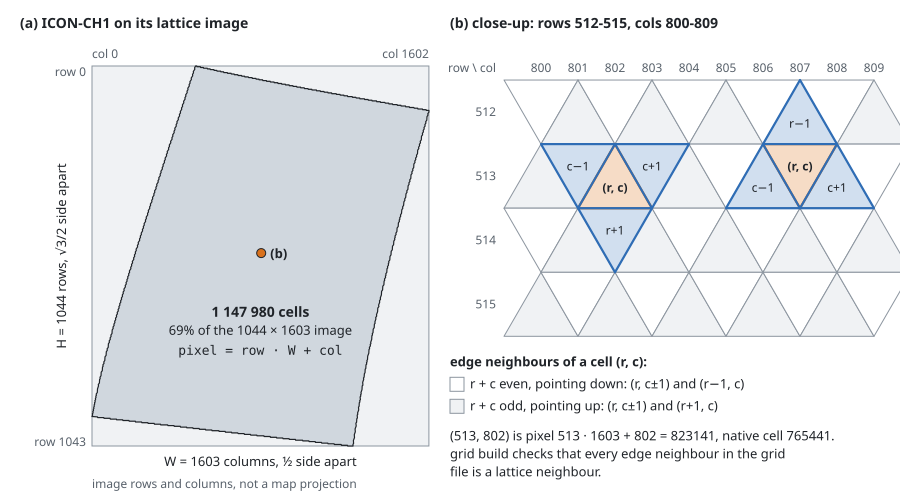
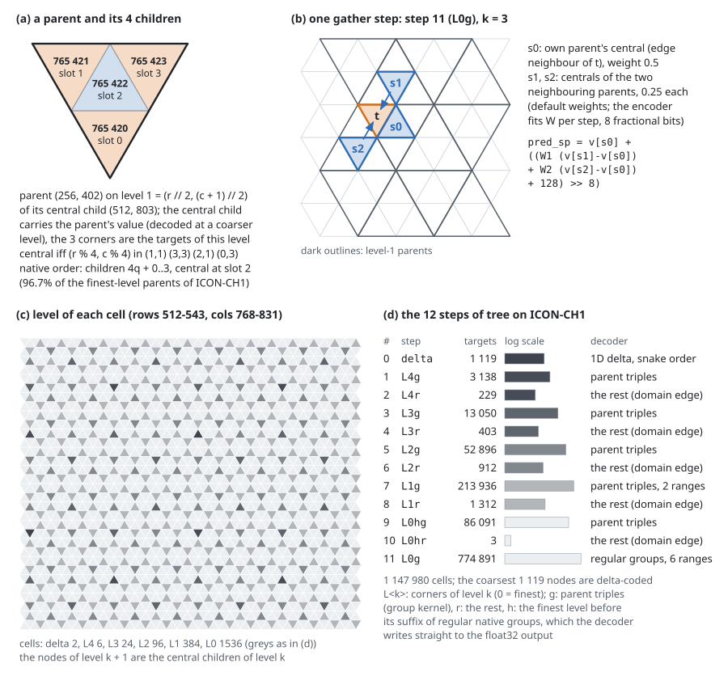
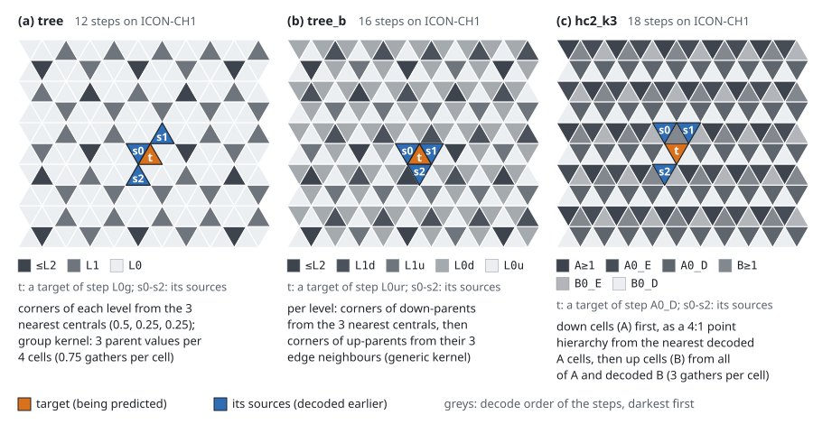
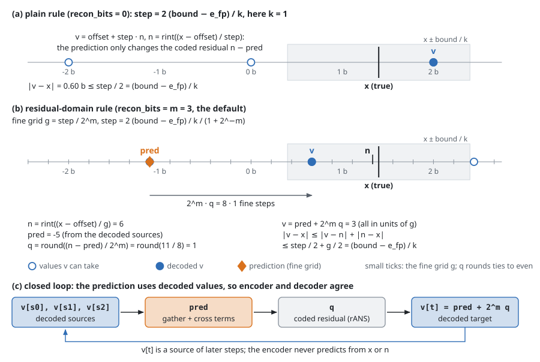
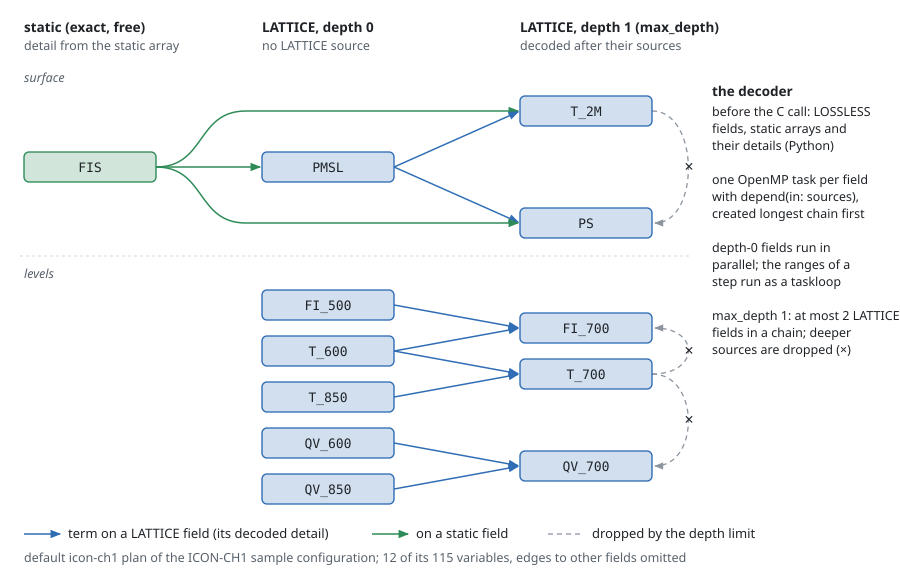
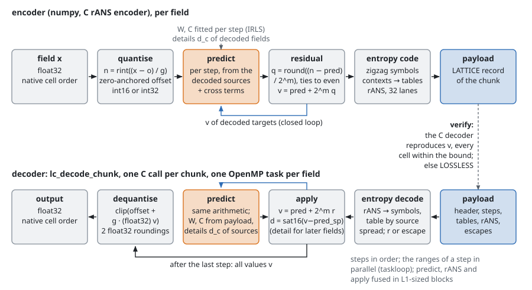
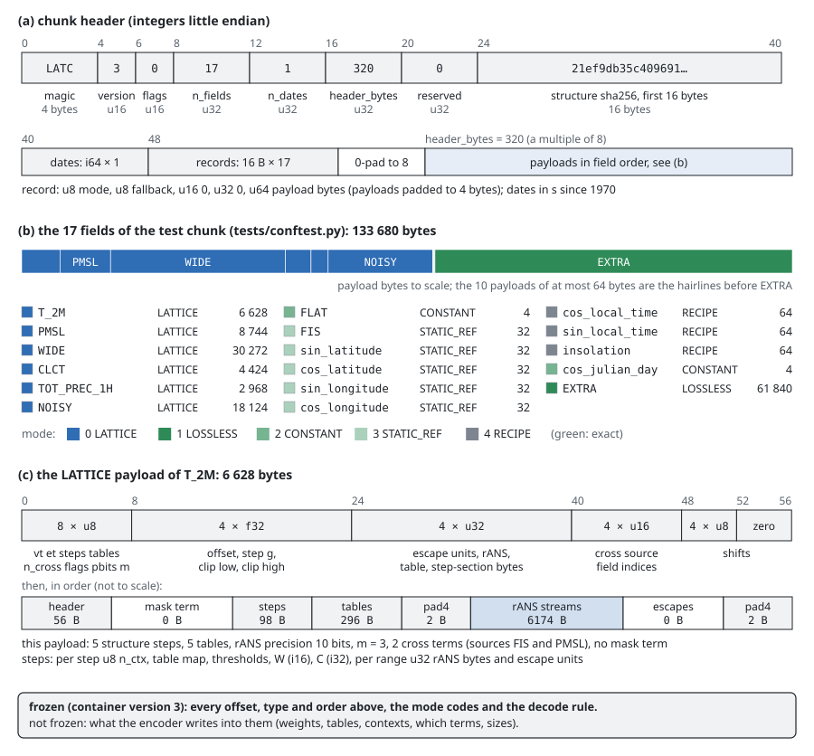

# The ICON lattice codec (`icon_lattice`)

How the codec turns one anemoi chunk into bytes and back, why it is built this way, and the versioned byte format. The
codec is used alone or last in a codec chain behind the field stages (`chain: true`, below). Configuration and usage are
in [the user guide](../user-guide.md), the package architecture in [design.md](../design.md), measurements in
[benchmarks.md](../benchmarks.md).

Contents: [Overview](#overview) · [The triangle lattice](#the-triangle-lattice) ·
[Prediction structures](#prediction-structures) · [Quantisation and the bound](#quantisation-and-the-bound) ·
[Entropy coding](#entropy-coding) · [Cross-variable terms and the plan](#cross-variable-terms-and-the-plan) ·
[Below-ground mask terms](#below-ground-mask-terms) · [Forcing recipes](#forcing-recipes) ·
[Static references](#static-references-constant-and-lossless-fields) · [The decoder](#the-decoder) ·
[The encoder](#the-encoder) · [Chunk format (container version 3)](#chunk-format-container-version-3)

## Overview

A chunk is a float32 array `(dates, variables, ensembles, cells)`, cells in the grid's native order. The codec codes it
field by field (a field is one `(date, variable, member)` slice) and chooses a mode per field:

| field | mode | what is stored |
|---|---|---|
| variable with a bound | LATTICE | integer quantisation at `2 bound / k`, prediction along a structure on the triangle lattice, cross-variable terms, context-modelled rANS |
| bit-identical in every cell | CONSTANT | one float32 |
| listed in `static_fields` | STATIC_REF | the sha256 of the field; the array lives in a sidecar file |
| forcing (cos / sin local time, insolation), valid date known or `physics.recipe_fit` (default) | RECIPE | 4 float64 coefficients of an analytic formula, plus exact values for the cells it misses |
| anything else, or a fallback | LOSSLESS | the configuration's `lossless` codec (default Blosc lz4) |

Why this shape (from measurements on the ICON-CH1 benchmark dataset):

* **The fields are rough at the bound scale.** After any spatial predictor the residual is unresolved signal, not
  smooth signal plus white noise (variogram nuggets sit at the quantisation-noise level). The nearest decoded
  neighbours predict best; averaging stencils, wavelet update steps and wide least-squares stencils lose. Prediction
  with 3 neighbours per cell, not transform coding.
* **Uniform scalar quantisation is near-optimal.** Quantisation at step `2 bound / k`, prediction and entropy coding
  at the entropy is within about 0.25 bit per value of the rate-distortion optimum for any (maximum error, RMSE)
  pair at these rates. The pointwise bound is structural, and `k` is the one knob for the error shape (plain rule:
  RMSE = bound / (k sqrt 3), at `log2 k` bits per value).
* **The information is far smaller than the bytes.** Static fields are identical in every chunk, forcings (local
  time, insolation) are analytic in (date, latitude, longitude), and surface and level fields obey physical
  relations (mean-sea-level pressure from surface pressure and orography, hydrostatic geopotential from temperature,
  10 m wind from the lowest levels). References, recipes and cross-variable terms remove what generic compressors
  store.
* **Decode speed is set by memory traffic.** Blosc lz4 decodes at under 1 ns per value, and a 32-lane AVX2 rANS
  decoder alone needs about 0.5 ns per symbol ([benchmarks.md](../benchmarks.md#decode-speed)). Every gathered
  neighbour costs about 0.5 ns per cell, so stencils stay at 3 sources and entropy tables stay in L1. Native cell
  order is the ICON refinement order at the finest level, so the last level decodes straight into the output.

## The triangle lattice

ICON limited-area grids are cut-outs of a regular triangular lattice. The codec places every cell on that lattice:
the *lattice* of a grid is the pixel index `row * W + col` of every cell (native order) in an image of shape
`(H, W)` (`layout.TriangleLatticeLayout`). `anemoi-datasets-codecs grid build` recovers it from the cell centres
of the ICON grid file and validates it against the file's neighbour table (every edge neighbour must be a lattice
neighbour). The lattice is content addressed by the sha256 of the int32 little-endian pixel index and stored as
`grids/<sha256>.npz`; readers never need the grid file. The ICON-CH1 lattice is bundled with the package (grid
`icon-ch1`): it is derived from the MeteoSwiss ICON-CH1 grid file `icon_grid_0001_R19B08_mch.nc` (grid uuid
`17643da2-5749-59b6-44d2-54a3cd6e2bc0`, as recorded in the file's `meta`) and distributed with the package under its
licence. Numbers for the ICON-CH1 grid are in [benchmarks.md](../benchmarks.md#grid-and-structures).



*The bundled ICON-CH1 lattice: (a) its cells on the lattice image `(H, W) = 1044 x 1603`, in image rows and columns;
(b) a close-up with the two triangle orientations (by the parity of `r + c`) and the 3 edge neighbours of a cell.*

The ICON refinement tree is visible on the lattice: a cell `(r, c)` is the central child of its parent when
`(r % 4, c % 4)` is one of `(1, 1)`, `(3, 3)`, `(2, 1)`, `(0, 3)`, and the parent sits at `(r // 2, (c + 1) // 2)` on
the next coarser lattice (validated against the grid file's parent indices). In native order almost all parents of
the finest level have their 4 children consecutive, with the central child at a fixed slot (2).

## Prediction structures

A structure is an ordered list of steps over the cells, a deterministic function of the lattice and the structure id
(`structure.py` is the model, `structures/` the frozen builders). The first step is a **delta** step: its targets (the
coarsest cells, in snake order on their sub-lattice) are coded with a 1D delta predictor. Every further step is a
**gather** step: each target `t` is predicted from `k` already decoded sources `s_0..s_{k-1}` (ordered by distance;
`s_0` is the nearest) with per-step weights:

```
pred_sp = v[s_0] + ((sum_{j>=1} W_j (v[s_j] - v[s_0]) + 128) >> 8)        W_j: int16, 8 fractional bits
```

Every cell is the target of exactly one step, and every source is decoded by an earlier step. Where a source falls
outside the domain, the nearest present cell replaces it.



*The `tree` structure, drawn on the bundled ICON-CH1 lattice: (a) a parent and its 4 children, consecutive in native
order with the central child at slot 2; (b) one gather step, a corner predicted from the 3 nearest centrals; (c) the
refinement level that decodes each cell of a cut-out; (d) the steps of `tree` for this grid.*

| structure | built from | trade-off |
|---|---|---|
| `tree` (default) | the ICON refinement tree in native order: the value of a parent is its central child's; the corners of each level are predicted from the 3 nearest centrals (own parent and the two neighbouring parents; default weights 0.5, 0.25, 0.25); at most 2000 coarsest nodes delta-coded | fastest decode: the 3 parent values are loaded once per group of 4 cells (0.75 gathers per cell) and its last step writes the output directly |
| `tree_b` | the tree with a B-pass at every level: corners of "down" parents first, from the 3 nearest centrals, then the corners of "up" parents from their 3 edge neighbours (the central sibling and 2 corners of neighbouring down-parents, decoded just before) | smaller than `tree` at k = 1, slower to decode (generic kernel for the up-corners) |
| `hc2_k3` | the honeycomb two-orientation hierarchy: orientation A (a triangular point lattice) as a 4:1 hierarchy of row-midpoint and diagonal steps, then orientation B from all of A and decoded B, every step capped at the 3 nearest decoded cells | smallest of the three at k = 1, 3 gathers per cell |



*The three structures on the same cut-out of the ICON-CH1 lattice, in grey the decode order of their steps, with one
target and its 3 sources each: `tree` predicts all corners of a level from centrals, `tree_b` the up-parent corners
from their edge neighbours after the down-parent corners, `hc2_k3` the down cells (orientation A) before the up cells.*

The number of steps depends on the grid's refinement levels. Step counts, sizes and decode times on the ICON-CH1
benchmark dataset are in [benchmarks.md](../benchmarks.md).

Weights are per step: the encoder fits robust (IRLS, about L1) sum-to-one least squares on a deterministic
subsample of the targets, rounds them to 8 fractional bits, and keeps the structure's default weights where those
code smaller (`fit: fixed` always uses the defaults). Large gather steps are split into independent *ranges* (below)
so that one field decodes on several threads.

Structures are part of the format: a chunk stores the first 16 bytes of its structure's sha256, readers rebuild the
structure from the lattice (cached on disk) and refuse a chunk whose sha does not match. A new
structure gets a new id; `tree`, `tree_b` and `hc2_k3` of structure version 3 are frozen.

## Quantisation and the bound

Values are integers on a grid `g` with a zero-anchored offset: `offset = float32(g * j)` for the integer `j` nearest
the field's mid-range, so `offset + g * (-j)` is exactly 0 and exact zeros (precipitation, clouds, CAPE) decode
exactly. The decoder outputs `clip(offset + g * (float32)v)`: a float32 multiply, then a float32 add, never fused,
then the variable's clip.

**Plain rule** (`m = 0`): `g = step = 2 (bound - e_fp) / k`, `v = rint((x - offset) / step)`, so the error is at most
`step / 2 <= bound / k`. `e_fp` (one float32 ulp of the largest magnitude plus one of the range) is the margin for the
float32 reconstruction; if a cell still misses the bound, the step shrinks by `1 - 2^-12` and the field is
re-quantised.

**Residual-domain reconstruction** (`m = recon_bits`, default 3). Values live on a fine grid `g = step / 2^m`;
predictions are integers on that fine grid; the encoder runs closed loop (it predicts from reconstructed values, exactly
as the decoder will) and, with `rounding: direct` (the default), codes `q = rint((x' - pred) / 2^m)` from the unrounded
value `x' = (x - offset) / g`, ties to even, so the error is at most `step / 2` and `step = 2 (bound - e_fp) / k`; the
reconstruction is `v = pred + 2^m q`. With `rounding: grid` the encoder rounds the value to the fine grid first,
`n = rint(x')`, and codes `q = round((n - pred) / 2^m)`, ties to even; the error is then at most `step / 2 + g / 2`,
so `step = 2 (bound - e_fp) / k / (1 + 2^-m)`. Both are read by the same decoder. If a cell misses after float32
rounding, the step shrinks by `1 - 2^-10` and the field is re-coded. Compared with the plain rule, the prediction is
no longer rounded to the coarse grid: wherever the residual rounds to zero the cell keeps the prediction's precision.
At k = 1 this (with `rounding: grid`) is 2-4% smaller and 12-15% lower in RMSE at the same bound (median |error| /
bound 0.42 instead of 0.50); at k = 3-5 it is 1-2% larger and about 10% lower in RMSE. Ties to even matter: rounding
ties up biased every reconstruction by `+g / 2`. Fields with more than 1% exact zeros use the plain rule
so that the zeros stay exact. Values are int16 when they fit, else int32.



*Both rules on a number line in units of the bound, k = 1: (a) the plain rule rounds `x` to the grid `offset + step
n`; (b) the residual-domain rule rounds `x` to the fine grid `g` and codes `q`, the distance from the prediction in
steps of `2^m g`; (c) the closed loop: predictions use decoded values only, so the decoder reproduces them exactly.*

**The guarantee.** The encoder decodes every LATTICE payload with the C decoder and checks that the values equal its
own and that every cell is within the bound after the clip; a field that fails is stored losslessly (`fallback` 1),
a field whose lossless payload is smaller too (`fallback` 2). So every decoded value is within its variable's bound
or exact.

Options that change the error shape: `k` (maximum error `bound / k`; RMSE / bound about 0.48 at k = 1 and 0.17 at k = 3
on the ICON-CH1 benchmark dataset with the residual-domain rule and `rounding: grid`, 0.52 at k = 1 with `direct`),
`recon_bits` (0 = plain rule), `rdoq` (for fields under 2.5 bits per value also try k = 2 with encoder-chosen values
inside the bound, keep the smaller; plain rule only). The decoder does not depend on any of them.

## Entropy coding

Residuals `r` become symbols: `zigzag(r)` for 0..254, symbol 255 for an escape whose value goes to a side stream
(int16, int32, or LEB128 varints of `zigzag(r) - 255`, whichever is smallest; most escapes are just beyond +-127 and
take one byte as varints).

**Contexts.** The context of a target is the spread `max - min` of the values of its first `min(k, 4)` sources,
bucketed by up to 7 per-step thresholds into at most 8 buckets (`contexts`); each step maps its buckets to entropy
tables. The table layout (`tables: auto`) is the smallest of: no contexts, per-step thresholds with per-(step,
bucket) tables, or global thresholds with tables shared by all steps of the field, counting the exact coded size,
the table bytes and `table_penalty` bytes per table (the decode cost of building it). At most 255 tables per field.

**rANS.** Static rANS (range asymmetric numeral systems; J. Duda, "Asymmetric numeral systems",
[arXiv:1311.2540](https://arxiv.org/abs/1311.2540)) with 32 interleaved lanes (F. Giesen, "Interleaved entropy
coders", [arXiv:1402.3392](https://arxiv.org/abs/1402.3392); one AVX2 register of states), 12-bit probabilities
(`prob_bits` 10 is allowed and chosen by `auto` only when it costs less than 0.3%; in practice 12), 16-bit
renormalisation. Measured alternatives: tANS 2.5x slower, Huffman at least 1 bit per symbol, zstd on the symbols
1-2.5% larger; the rANS decoder runs at about 0.5 ns per symbol (about 60 ms for the 111 M symbols of an ICON-CH1 date
on one core) within 0.5% of the order-0 entropy.

**Ranges.** A large gather step is split into independent ranges (131072 targets, or 43648 parent triples for the
steps whose targets come in triples), each with its own rANS stream and escape slice, at most 16 per step. The
split is a function of the structure only; it lets the decoder run one field's ranges on several threads at a small
cost in size (a 32-lane state flush per range).

## Cross-variable terms and the plan

When a field `G` is decoded, its *detail* `d_G[t] = sat16(v[t] - pred_sp[t])` (int16, fine-grid units) is what the
spatial prediction missed. A later field `F` adds fixed-point multiples of the details of up to 4 source fields:

```
pred = pred_sp + sum_c ((C_c * d_c[t] + 2^(sh_c - 1)) >> sh_c)          C_c: i32 per (step, source), sh_c <= 30
```

The encoder fits the coefficients jointly with the step weights (robust least squares on the same subsample) and drops a
term in a step where it does not pay, so a term costs nothing where it does not help. A static source (for example
orography) has no LATTICE detail; its detail is computed from the static array with the structure's default weights
(`details.spatial_detail` on `q = rint(x / s)`, the scale `s` a power of two chosen so that the details fit int16; exact
rule in the format section), identically on both sides.

**The plan.** Which sources a field may use is the *plan*, produced by the physics layer
(`physics/terms.py`) from the variable names and the configured name convention, and consumed by the core as
target -> sources (it knows no names). The terms are written against physical roles and level indices; the
convention maps each role to the dataset's variable name and each level family to a name pattern and its ordered
levels (table below). A role the convention does not map, or a variable absent from the dataset, drops the terms
that need it. The candidate terms (user guide, "Physics layer"):

* surface: mean-sea-level pressure <- orography; 2 m temperature <- orography, mean-sea-level pressure; surface
  pressure <- mean-sea-level pressure, orography, 2 m temperature; skin temperature <- 2 m temperature, orography,
  mean-sea-level pressure; 2 m dew point <- 2 m temperature, specific humidity of the two lowest levels, orography,
  mean-sea-level pressure; each 10 m wind component <- the same component on the two lowest levels, orography;
  most-unstable CAPE / CIN <- mixed-layer CAPE / CIN; 6 h precipitation <- 1 h precipitation;
* inter-level (temperature, the wind components, specific humidity, vertical velocity): odd level indices from their
  two even neighbours (specific humidity also from temperature at the same level); with `cross: chain` even levels
  also from the even level two above;
* hydrostatic (geopotential on levels): the lowest level from orography and the temperature there; others from two
  levels below and the temperatures in between, or interpolated between neighbours. With `cross: shallow` (default)
  and a `star_level`, every upper level uses the geopotential of the star level (500 hPa in both built-in
  conventions), which keeps the decode DAG shallow; `cross: on` uses the deeper chain; `cross: off` drops all cross
  terms.

The roles, the keys that name them in a custom convention, and their names in the two built-in conventions
(`icon-ch1`: the COSMO names of the anemoi ICON-CH1 datasets, which are also the keys; `ifs`: ECMWF short names as
in anemoi's ERA5 / IFS datasets; both on the 13 pressure levels 50 to 1000 hPa):

| role | key | `icon-ch1` | `ifs` |
|---|---|---|---|
| orography (surface geopotential) | `FIS` | `FIS` | `z` |
| mean-sea-level pressure | `PMSL` | `PMSL` | `msl` |
| surface pressure | `PS` | `PS` | `sp` |
| 2 m temperature | `T_2M` | `T_2M` | `2t` |
| skin temperature | `SKT` | `SKT` | `skt` |
| 2 m dew point | `TD_2M` | `TD_2M` | `2d` |
| 10 m wind | `U_10M`, `V_10M` | `U_10M`, `V_10M` | `10u`, `10v` |
| mixed-layer / most-unstable CAPE | `CAPE_ML`, `CAPE_MU` | `CAPE_ML`, `CAPE_MU` | not mapped |
| mixed-layer / most-unstable CIN | `CIN_ML`, `CIN_MU` | `CIN_ML`, `CIN_MU` | not mapped |
| 1 h / 6 h precipitation | `TOT_PREC_1H`, `TOT_PREC_6H` | `TOT_PREC_1H`, `TOT_PREC_6H` | not mapped |
| temperature on levels | `T` | `T_{level}` | `t_{level}` |
| wind on levels | `U`, `V` | `U_{level}`, `V_{level}` | `u_{level}`, `v_{level}` |
| specific humidity on levels | `QV` | `QV_{level}` | `q_{level}` |
| vertical velocity on levels | `OMEGA` | `OMEGA_{level}` | `w_{level}` |
| geopotential on levels | `FI` | `FI_{level}` | `z_{level}` |

`plan.finalize` then applies `max_depth` (default 1: the longest chain of cross terms between LATTICE fields, which
must be decoded one after the other; static and lossless sources are free) and keeps at most 4 sources per
target. The plan is a DAG; its depth is the decoder's critical path at many threads. The depth limit costs a little
size against the unlimited plan ([benchmarks.md](../benchmarks.md#physics-layer)). `anemoi-datasets-codecs plan`
reports every candidate term with the sources applied and dropped, and why; `anemoi-datasets-codecs info CHUNK -v`
shows what a chunk actually uses.



*Part of the default `icon-ch1` plan of the ICON-CH1 sample configuration as a decode DAG: cross terms run from
sources to targets, sources that would make a chain deeper than `max_depth` are dropped, and the decoder runs every
field as an OpenMP task that waits for its sources.*

## Below-ground mask terms

Optional (`physics.below_ground`, off by default; pressure levels only). On pressure levels ICON fills the cells where
the surface pressure is below the level by extrapolation from surface fields. For the three lowest levels, the cells
where the decoded surface pressure is below the level are predicted by a per-chunk linear model of surface fields
(geopotential from orography, temperature from 2 m temperature and surface pressure, wind from the 10 m wind, vertical
velocity from the level above), evaluated in float64 and rounded to the value grid (`lc_mask_predict`, same code on both
sides), with their own entropy table. The model coefficients are a float64 least-squares fit per chunk, so with these
terms on the chunk bytes depend on the numpy version (the plan does not). Their worth on the ICON-CH1 benchmark dataset
is in [benchmarks.md](../benchmarks.md#physics-layer).

## Forcing recipes

`cos_local_time`, `sin_local_time` and `insolation` are analytic in the valid date and the cell's latitude and
longitude. With the date known (`encode(x, dates=...)`), the encoder computes 4 float64 coefficients from it, the
decoder evaluates the formula on the decoded `sin/cos_latitude` and `sin/cos_longitude` fields (statics or lossless), in
float64 without fused operations, then casts to float32. Cells further than `physics.recipe_bound` (1e-6) from the data
are stored exactly as patches; a field with more than 1% such cells, without its inputs as static or lossless fields, or
without a valid date is stored losslessly instead. Zarr passes no dates to a codec, so a store written through zarr
would store the forcings losslessly; with `physics.recipe_fit` (the default) the encoder recovers the coefficients from
the field itself (`recipes.fit_params`: the formula fitted by least squares on every 8th cell with `math.fsum` sums, the
angle snapped to a whole second of the day for the local time, the best of 366 days x 3 hours for the insolation, then
the coefficients of that date, so they do not depend on the numpy version) and writes the same payload with the date
`INT64_MIN` (unknown); `recipe_fit: false` stores them losslessly. The decoder reads only the coefficients. The formulas
are in the format section below. A forcing that has a bound is a LATTICE field instead, never a recipe.

## Static references, constant and lossless fields

A variable listed in `static_fields` is coded as STATIC_REF: the sha256 of its float32 little-endian bytes. The array
lives in a sidecar file `statics/<sha256>.f4.blosc` (Blosc zstd 9, bit shuffle), found on the sidecar search path and
verified against its sha256 when read. The encoder *captures* a static it has not seen into the store's sidecar (and the
cache) and references it only once it is durably available; otherwise the field is stored losslessly with a warning. A
"static" field that changes between chunks is captured per value, up to 4 values per name and codec, then stored
losslessly. With `options.statics: inline` the field follows its sha in the chunk (Blosc lz4), so the chunk is
self-contained at the cost of carrying the static fields in every chunk. The user guide has the search order and the
failure modes. In a codec chain the `static_ref` stage takes the static fields out of the chunk before this codec sees
it ([static_ref.md](static_ref.md)), with the same sha256 rule, capture policy and sidecar files.

A field whose cells are all bit-identical is CONSTANT (one float32). LOSSLESS applies the configuration's
`lossless` numcodecs codec (default `{"id": "blosc", "cname": "lz4", "clevel": 5, "shuffle": 1}`) to the float32
field in native order; it is not stored in the chunk.

## The decoder



*One LATTICE field: the encoder quantises, predicts every step from decoded values, entropy-codes the residuals and
verifies the payload with the C decoder; the decoder runs the same prediction and dequantises the values at the end.*

One C call per chunk (`lc_decode_chunk`, `csrc/decode.c`), after Python has decoded the LOSSLESS fields into the
output buffer, looked up the static arrays and computed the static details:

* **Field DAG.** One OpenMP team; every decodable field is a task with `depend` clauses on its sources (cross
  details, mask sources, recipe inputs), created in topological order, longest remaining chain first. Inside a
  field, the ranges of a step run as a `taskloop`, so a field decodes on several threads.
* **Per field.** Build the rANS tables, then run the steps in order: decode symbols, predict (gather, weights,
  cross terms, mask), apply the residuals. Values and details live in decode order (the order of the steps'
  targets), so every step writes contiguously and the coarse levels stay in a compact prefix. The tree's
  parent-triple steps use group kernels (the 3 neighbouring centrals loaded once per group). The last step of
  `tree` (the finest level's suffix of regular groups of 4 consecutive cells in native order) writes the float output
  directly, 32 floats per 8 groups, with non-temporal stores; other cells are dequantised by a vectorised gather. The
  context path runs predict / rANS / apply in L1-sized blocks. Large buffers come from a pool reused across calls.
* **Determinism.** All arithmetic on values is integer; the only floating-point operations are the dequantisation
  (two float32 roundings), the float64 recipe and mask formulas and the static-detail quantisation, all compiled
  with `-ffp-contract=off` (no fused multiply-add). The AVX2 and the portable scalar variant decode bit-identically,
  and the result does not depend on the thread count.
* **Threads.** `ANEMOI_DATASETS_CODECS_THREADS`, else 1 in a torch DataLoader worker, else min(16, CPUs); 1 in a
  process forked after a threaded decode (GNU libgomp's pool does not survive fork). The C call releases the GIL.

## The encoder

Python / numpy plus the C rANS encoder, the C decoder (for verification) and a C pass of the weight fits
(`csrc/encode.c`; the least-squares solves are numpy's own LAPACK routine, called without the GIL so that the field
threads fit in parallel). Encoder speed is secondary ([benchmarks.md](../benchmarks.md#encode-speed)). Per chunk:
finiteness check; constants, statics, recipes and lossless fields first; then the lossy fields in waves of the decode
DAG (sources first, so their details exist), each wave on a thread pool. Per lossy field: quantise, fit weights and
cross coefficients per step, choose the context and table layout, rANS-code, decode with the C decoder and verify. For
a given package version, configuration and numpy version the encoder is deterministic. It is not part of the format:
a later version may write different (smaller, more accurate) bytes or change a default, always decodable by the
version 3 decoder and always within the bound; such changes are listed in the changelog.

---

## Chunk format (container version 3)

This section fixes the byte layout of a chunk, the format this package writes. Container version 3 is the first public
version (versions 1 and 2 were development formats and are not read). The reference implementation is `container.py`
(container, LATTICE header), `encoder.py` (writer of LATTICE payloads), `fields.py` and `recipes.py` (writer of RECIPE
payloads) and `csrc/decode.c` (reader). All integers are little endian; "pad4" means zero bytes up to the next multiple
of 4.

### Names that are part of the format

Stores do not depend on the Python package name. These format-level names do not change: the Zarr format 3 codec
names `icon_lattice` and `icon_lattice_bytes` (entry point `zarr.codecs`), the sidecar directory
`<store>/.codecs/`, the container (magic `LATC`, version 3) and the chunk bytes.

### Chain mode (`chain: true`)

With the configuration key `chain: true` the codec follows field stages in a codec chain
([design.md](../design.md#field-stages-and-codec-chains)). Its `variables` are the fields that reach it, so the
array's chunk grid may have another field count: the codec checks at array creation only `(dates, fields,
ensembles, cells)` chunks with its ensembles and cells that hold every field of a date, and the field count of each
chunk when it codes it. An `icon_lattice_bytes` chunk of such an array may then be wrapped in the chain envelope:
magic `FCHN`, the shape of the field array the codec coded, the stages' headers, and this container as the opaque
payload ([envelope.md](envelope.md)). The container inside is unchanged (version 3), and so is a chunk written from a
bare input: with or without `chain`, a codec used alone writes the same bytes. `get_config()` writes `chain` only
when it is true. Without the key the codec never reads an envelope.

What differs for the codec in the chain `[field_terms, static_ref, icon_lattice_bytes]`
(`anemoi-datasets-codecs physics expand` writes its configuration; the chunk format is the same):

* **No static fields.** `static_ref` takes them out of the chunk, so the configuration has `static_fields: []` and
  the codec writes no STATIC_REF records. Its plan, resolved from its own variables, has no static source: the
  orography parts of the surface and lowest-level geopotential terms are coded by `field_terms` ahead of it, the
  other terms keep their lossy sources (the closed loop below), and terms whose only source was static are gone.
* **No forcing recipes.** Their latitude / longitude inputs are static fields, which `static_ref` takes, and zarr
  passes no dates. The forcings are LOSSLESS, or LATTICE fields when they have a bound (`physics expand
  --forcing-bound 1e-6` gives them one).
* **Residuals instead of some fields.** A `field_terms` target reaches the codec as a residual, configured with the
  stage's reduced bound `b_L = b (1 - m)` and without a clip; the codec codes and verifies it like any field. Where
  it stores the residual LOSSLESS, the decoded target is within its bound but not bit-exact
  ([field_terms.md](field_terms.md#the-error-bound)).

The decoder reads every record type in both forms: single-codec chunks with STATIC_REF and RECIPE records and chained
chunks decode with the same decoder.

### Compatibility promise

The package's promise, with what changes at 1.0, is in [goals.md](../goals.md#compatibility-promise). For this codec:

1. **Container version 3 is frozen.** Its byte layout and the decoder's arithmetic never change under this version
   number: a chunk with magic `LATC` and version 3 decodes **bit-identically** to what its writer verified, with every
   later release, or fails with a clear error. A change gets a new container version; readers keep decoding version 3.
   Golden chunks with the hashes of their decoded values guard it ([contributing.md](../contributing.md)).
2. **The decoder is exact and portable.** All arithmetic on quantised values is integer; the only floating-point
   operations are the dequantisation `offset + step * (float32)v` (two IEEE float32 roundings, never fused), the
   float64 recipe and mask formulas (never fused) and the static-detail quantisation (float64, below). The kernels are
   compiled with `-ffp-contract=off`; the AVX2 and the scalar variant produce identical bits (tested). Decoding does
   not depend on the thread count.
3. **Structures are part of the format.** A chunk stores the first 16 bytes of its structure's sha256. The
   structures `tree`, `tree_b` and `hc2_k3` of structure version 3 are frozen: their builders must keep producing the
   same steps from the same lattice (the sha would no longer match, and decoding fails with a clear error rather than
   producing wrong values). New structures get new ids.
4. **The encoder is not frozen.** A later version may write different (smaller, more accurate) bytes for the same
   input or change a default, always decodable by the version 3 decoder and always within the bound; such changes are
   listed in the changelog. For a given package version, configuration and numpy version, encoding is deterministic.
   The byte baselines ([contributing.md](../contributing.md)) guard that a change meant to keep the bytes does keep
   them.
5. **Configuration and sidecars.** The codec configuration (schema version 1, [user guide](../user-guide.md)) is
   stored complete in `zarr.json`; its keys keep their meaning, new keys may be added, and later versions code new
   chunks of a store as its stored configuration says. Sidecar files (lattice `.npz`, static `.f4.blosc`) are content
   addressed by sha256 and their format is frozen with this document.

### Container

| offset | type | content |
|---|---|---|
| 0 | 4 bytes | magic `LATC` |
| 4 | u16 | container version = 3 |
| 6 | u16 | flags = 0 |
| 8 | u32 | `n_fields` (dates x variables x ensembles, C order) |
| 12 | u32 | `n_dates` |
| 16 | u32 | `header_bytes`: offset of the first payload, a multiple of 8 |
| 20 | u32 | reserved = 0 |
| 24 | 16 bytes | first 16 bytes of the structure's sha256 |
| 40 | i64 x `n_dates` | valid date of each date in the chunk, seconds since 1970-01-01 (`INT64_MIN` = unknown) |
| .. | 16 bytes x `n_fields` | record: u8 mode, u8 fallback, u16 0, u32 0, u64 payload bytes |
| .. | | zero padding to `header_bytes`, then the payloads in field order |

Payload byte counts include their padding to a multiple of 4; the chunk size is `header_bytes + sum(payload bytes)`.
`fallback` is informative (why a lossy field is stored losslessly: 0 it is not, 1 the lossy coding failed or missed
the bound, 2 lossless was smaller).



*Container version 3 as `container.py` writes it, for the synthetic test chunk of `tests/conftest.py`: (a) the chunk
header; (b) the fields in order with their modes and payload sizes; (c) the LATTICE payload of one field. The offsets,
types and order are frozen; what the encoder writes into them is not.*

### Field modes

| mode | name | payload |
|---|---|---|
| 0 | LATTICE | lossy field, below |
| 1 | LOSSLESS | the configuration's `lossless` numcodecs codec applied to the float32 field in native cell order |
| 2 | CONSTANT | one float32 (every cell bit-identical) |
| 3 | STATIC_REF | 32-byte sha256 of the field's float32 bytes; with `statics: inline` followed by the field, numcodecs Blosc (lz4, 5, byte shuffle). The array comes from the inline data or a sidecar ([user guide](../user-guide.md#static-fields-grids-and-sidecars)) |
| 4 | RECIPE | analytic forcing, below |

The LOSSLESS codec is not stored in the chunk: it is the `lossless` entry of the codec configuration (default
`{"id": "blosc", "cname": "lz4", "clevel": 5, "shuffle": 1}`).

### LATTICE payload

Header (56 bytes):

| offset | type | content |
|---|---|---|
| 0 | u8 | `vt`: value width, 2 (int16) or 4 (int32) |
| 1 | u8 | `et`: escape coding, 2 (int16), 4 (int32) or 1 (LEB128 varints of `zigzag(r) - 255`) |
| 2 | u8 | number of structure steps (must equal the structure's) |
| 3 | u8 | number of entropy tables (1..255) |
| 4 | u8 | `n_cross`: cross-variable terms (0..4) |
| 5 | u8 | flags: bit 0 clip low, bit 1 clip high, bit 2 mask term present |
| 6 | u8 | `pbits`: rANS probability precision, 10 or 12 (0 means 12) |
| 7 | u8 | `m`: residual shift (residual-domain reconstruction), 0..8 |
| 8 | f32 x 4 | `offset`, `step` (the fine grid `g`), clip low, clip high |
| 24 | u32 x 4 | escape units (values, or bytes for `et` = 1), rANS bytes, table bytes, step-section bytes |
| 40 | u16 x 4 | cross source field indices in the chunk (0xffff unused) |
| 48 | u8 x 4 | cross shifts `sh_c` (<= 30) |
| 52 | 4 bytes | zero |

Then, in order:

1. **Mask term** (flag bit 2): u16 mask source field, u8 `n_feat` (<= 4), u8 mask table, f32 threshold, f64 `c0`,
   then per feature u16 field A, u16 field B (0xffff: none), u32 0, f64 coefficient.
2. **Steps** (step-section bytes), per structure step: u8 `n_ctx` (1..8, 1 for the delta step), `n_ctx` bytes of
   table map, `n_ctx - 1` i32 context thresholds; for gather steps `k - 1` i16 weights (`W_1..W_{k-1}`, 8 fractional
   bits) and `n_cross` i32 cross coefficients; then per range of the step (below) u32 rANS bytes (0 for a step with
   a single range) and u32 escape units.
3. **Tables** (table bytes), per table: u8 `M`, varint frequencies of symbols `0..M-1`, varint frequency of symbol
   255 (escape); frequencies sum to `2^pbits`. pad4.
4. **rANS**: first the serial stream of all single-range steps (symbols of consecutive steps form segments, lanes
   restart at every segment), then one stream per range of each multi-range step, in step order. A stream is u32
   lane count (= 32), u32 state[32], u16 renormalisation words, 16 zero bytes. Symbol `i` of a segment is coded by
   lane `i % 32`; decoding: `e = table[x & (2^pbits - 1)]`, symbol `e & 255`, `x = (e >> 20) * (x >> pbits) +
   ((e >> 8) & 4095)`, and when `x < 2^16`, `x = x << 16 | next word`. Table entry for slot `s` of symbol `y` with
   cumulative start `c`: `y | (s - c) << 8 | freq(y) << 20`.
5. **Escapes**: the escape stream, per (step, range) slices in order. pad4.

**Ranges.** A delta step is one range. A gather step whose targets come as parent triples (`k = 3`, every 3
consecutive targets share source 0 and draw sources 1-2 from 3 distinct cells; ``Structure.step_groups``) is split
into ranges of 43648 triples, any other gather step into ranges of 131072 targets; at most 16 ranges. This is a
function of the structure only.

**Decoding.** Steps run in order; values `v` are integers on the fine grid. Delta step: `v[t_i] = v[t_{i-1}] + 2^m
r_i` (with `v[t_{-1}] = 0`). Gather step, for each target `t` with sources `s_0..s_{k-1}` (decoded earlier):

```
pred_sp = v[s_0] + ((sum_{j>=1} W_j (v[s_j] - v[s_0]) + 128) >> 8)
pred    = pred_sp + sum_c ((C_c * d_c[t] + 2^(sh_c - 1)) >> sh_c)        (term 0 when sh_c = 0)
pred    = M[t] where the mask term applies (and the symbol uses the mask table)
v[t]    = pred + 2^m r
d[t]    = sat16(v[t] - pred_sp)
```

`r` is `zigzag^-1(symbol)` for symbols 0..254 and the next escape value for symbol 255. The weighted sum and the
cross products fit in 32 bits (the encoder checks `|W| |v - v_0|` and `|C_c| max|d_c|` against `2^30`), so 32- and
64-bit evaluation agree; `>>` is an arithmetic shift. The context bucket of a target is the number of
the step's thresholds strictly below `max - min` of `v` over its first `min(k, 4)` sources; its table is the step's
table map at that bucket. The output is `clip(offset + step * (float32)v)` (float32 multiply then add, clip low then
high when the flags say so).

**Cross details** `d_c` are int16 arrays in cell order: for a LATTICE source field, its `d` above; for a STATIC_REF
source field `x` (float32), the details of `q = rint(x / s)` under the structure with its default weights
(`spatial_detail`: the same prediction rule with the steps' default weights rounded to 8 fractional bits and no
cross terms), where `s = 2^floor(log2(max|x| / 2^20))` (`max|x| = 1` when 0), doubled until every detail fits in
`[-2^15, 2^15)`.

**Mask prediction** (optional below-ground term): where the decoded float field M is `< threshold`, `M[t] =
clamp(nearbyint((c0 + sum_j coef_j A_j (B_j or 1) - offset) / step))` in float64, clamped to the int16 / int32 value
range (`lc_mask_predict`); elsewhere the gather prediction applies.

### RECIPE payload

64-byte header: u8 recipe id (1 cos_local_time, 2 sin_local_time, 3 insolation), u8 4, u16 0, u16 x 4 source field
indices (sin_latitude, cos_latitude, sin_longitude, cos_longitude; 0xffff unused), u32 0, f64 x 4 coefficients
`p`, u32 `n_patch`, u32 0, i64 valid date (informative); then `n_patch` x (u32 cell, f32 value). In float64, on the
decoded float32 source fields, without fused operations, then cast to float32:

```
1: p0 cos_lon - p1 sin_lon
2: p1 cos_lon + p0 sin_lon
3: max(0, p0 sin_lat + p1 cos_lat (p2 cos_lon - p3 sin_lon))
```

then the patched cells take their stored values.

### Structures

A structure is a list of steps over the cells (native order): one delta step, then gather steps of `k` sources per
target. It is a deterministic function of the lattice (the pixel index `row * W + col` of every cell and the image
shape, ``layout.TriangleLatticeLayout``) and the structure id (builders in `structures/`, `STRUCTURE_VERSION = 3` in
`structure.py`). Its sha256 is over the UTF-8 string `"{id}/3/{n_cells}"`, then per step `"{kind}/{k}/{n}"`, the int32
targets and the int32 sources (`k x n`, row major). Readers rebuild the structure from the lattice file and compare the
first 16 bytes of the sha with the chunk's.

### Sidecar files

* Lattice: `grids/<sha256>.npz`, numpy `savez_compressed` with `pixel_delta` (int32, `diff` of the pixel index with
  a leading 0), `shape` (int64 x 2) and `meta` (JSON: name, uuid, n_cells, sha256, orientation, source). The sha256
  is over the int32 little-endian pixel index.
* Static field: `statics/<sha256>.f4.blosc`, numcodecs Blosc (zstd 9, bit shuffle) of the float32 little-endian field;
  the sha256 is over the float32 little-endian bytes.
