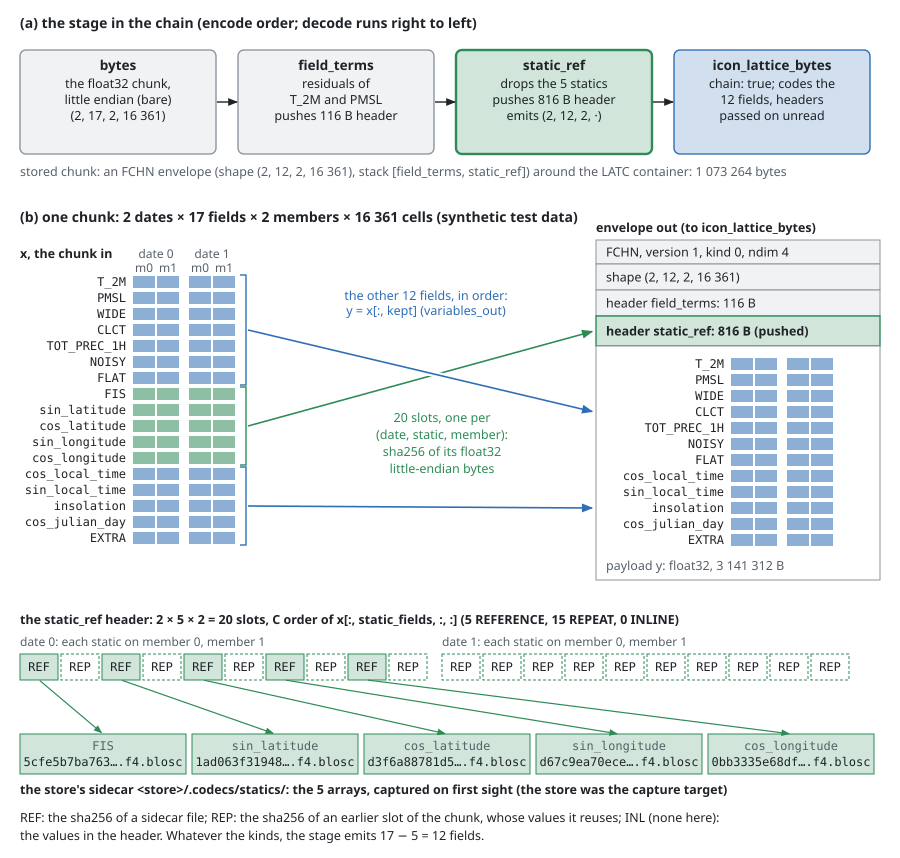
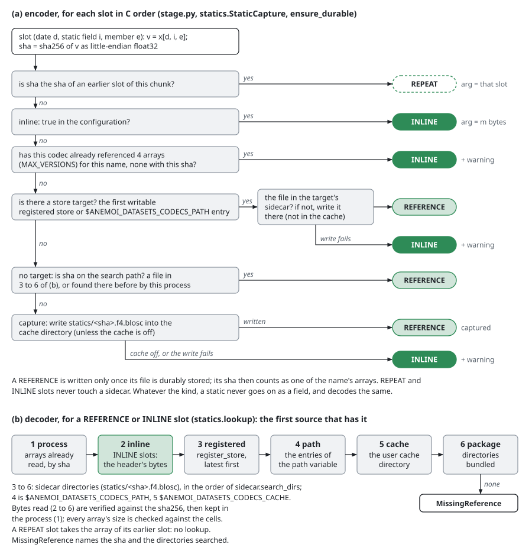
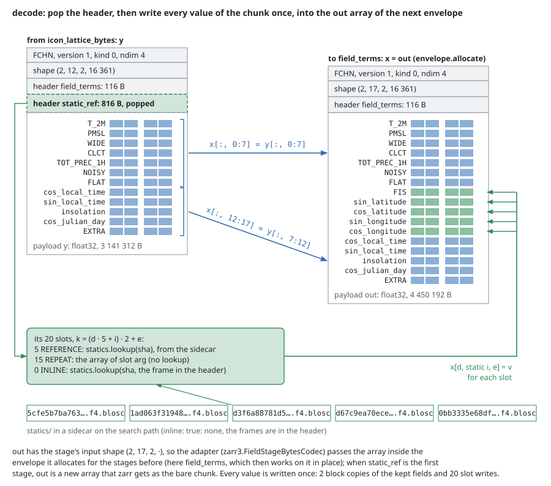
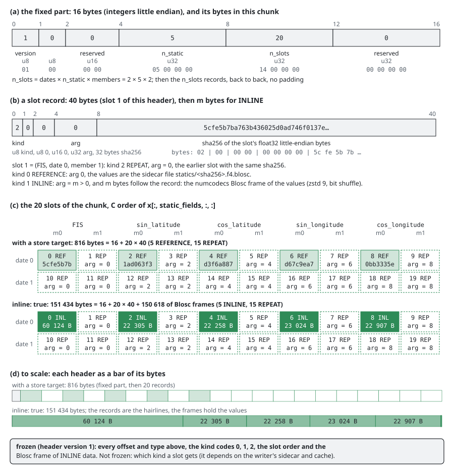

# The static reference stage (`static_ref`)

A field stage ([design.md](../design.md#field-stages-and-codec-chains)) that takes the static fields out of a chunk
(orography, latitude and longitude terms: fields identical in every chunk) and replaces each by a reference into the
shared sidecar, so the codec after it codes only the other fields. It is grid-agnostic and exact: every static field
decodes bit-identically. The reference implementation is `anemoi_datasets_codecs/static_ref/` (engine `StaticRef`,
header `header.py`, Zarr codec `StaticRefCodec`).

Contents: [Configuration](#configuration) · [Encode and decode](#encode-and-decode) ·
[Header (version 1)](#header-version-1) · [The sidecar](#the-sidecar) · [Compatibility promise](#compatibility-promise)

## Configuration

```json
{"name": "static_ref", "configuration": {"variables": ["FIS", "PMSL", "T_2M", "cos_latitude"],
                                         "static_fields": ["FIS", "cos_latitude"]}}
```

* `variables`: the names of the chunk's fields, in chunk order (the array's variables when the stage is first).
* `static_fields`: the static ones, a non-empty subset of `variables`; stored in chunk order.
* `inline` (optional, default false): store every static field inline in the header, so the chunks are
  self-contained and readers need no sidecar (the lattice codec's `statics: inline`).

The stage emits the other variables, in order (`variables_out`): the codec after it is configured with exactly those.
`anemoi-datasets-codecs physics expand` writes both configurations from a lattice codec configuration.



*(a) The stage in the chain `physics expand` writes for the synthetic test variables; (b) one chunk of 2 dates and 2
members: the 5 static fields leave as the 20 slots of the header (5 references to files of the store's sidecar, 15
repeats), the other 12 fields go on in order, and the header is pushed on the envelope.*

## Encode and decode

The chunk is the float32 array `(dates, fields, ensembles, cells)`. For every *slot*, one `(date, static field,
member)`, the stage computes the sha256 of the slot's float32 little-endian bytes (the rule of
`anemoi_datasets_codecs.statics`, shared with the lattice codec's STATIC_REF mode) and writes one record:

* **REFERENCE** when the array is durably stored. With a store target (the store being written, whose sidecar
  zarr's codec pipeline serves to the codecs; else the first registered store or writable
  `$ANEMOI_DATASETS_CODECS_PATH` entry) it must be in that store's sidecar, so that the store is self-contained, and
  is written there on first sight (not into the cache); without one, it is found on the sidecar search path or
  captured into the cache. At most 4 different arrays are captured per variable name and codec instance
  (`statics.MAX_VERSIONS`).
* **INLINE** otherwise (nowhere to persist it, more than 4 arrays for one name, or `inline: true`): the values travel
  in the header. A static is never passed on as a field, so the field count after the stage is always
  `len(variables) - len(static_fields)`.
* **REPEAT** when an earlier slot of the same chunk has the same sha256 (the same static on another date or member).
  This is checked first, so with `inline: true` too each different array of a chunk travels once.



*(a) The kind the encoder gives a slot, in the order the code decides it; (b) where the decoder looks for the array
of a REFERENCE or INLINE slot, first match wins.*

Decode restores the other fields to their places and every slot from the header (INLINE, REPEAT) or the sidecar
(REFERENCE, by sha256: `MissingReference` naming the searched directories when it is not there), in one write of the
whole chunk. Every array is verified against its sha256 when read.



*Decoding the chunk of the first figure: the kept fields go back in two block copies and the static slots are written
from the sidecar (or the header), all into the `out` array inside the envelope handed on to `field_terms`.*

Whether a slot is a reference or inline depends on the writer's environment (a store target, a cache), as for the
lattice codec's statics; the decoded chunk does not.

## Header (version 1)

The stage pushes its header on the chain envelope ([envelope.md](envelope.md)) under the stage id `static_ref`. All
integers are little endian.

| offset | type | content |
|---|---|---|
| 0 | u8 | header version = 1 |
| 1 | u8 | 0 |
| 2 | u16 | 0 |
| 4 | u32 | `n_static`: static fields per date and member |
| 8 | u32 | `n_slots` = dates x `n_static` x members |
| 12 | u32 | 0 |
| 16 | `n_slots` records | C order of `x[:, static_fields, :, :]`: dates, static fields (chunk order), members |

A record:

| offset | type | content |
|---|---|---|
| 0 | u8 | kind: 0 REFERENCE, 1 INLINE, 2 REPEAT |
| 1 | u8 | 0 |
| 2 | u16 | 0 |
| 4 | u32 | `arg`: 0 (REFERENCE); `m`, the bytes of inline data (INLINE, > 0); the index of the earlier slot (REPEAT) |
| 8 | 32 bytes | sha256 of the slot's float32 little-endian bytes |
| 40 | `m` bytes | INLINE only: numcodecs Blosc frame of the float32 values (zstd 9, bit shuffle, like sidecar files) |

There is no padding: the records follow each other and the last one ends the header. A header is valid only when its
version is 1, every reserved field is zero, every kind is known, a REPEAT names an earlier slot with the same sha256,
and the records end exactly at the end of the header. The decoder also checks `n_static` against the configuration
and `n_slots` against the envelope's dates and members, and the size of every array against the cell count.



*Header version 1 as `header.py` writes it for the chunk of the first figure: (a) the fixed part and (b) a record,
with their bytes; (c) its 20 slots with a store target and with `inline: true`; (d) both headers to scale.*

## The sidecar

REFERENCE slots point to `statics/<sha256>.f4.blosc` in a sidecar directory: the same files, directory
(`<store>/.codecs/`, a format-level name shared by every codec of the package) and search path as the lattice codec's
static fields ([icon_lattice.md](icon_lattice.md#sidecar-files); `anemoi_datasets_codecs.sidecar`).
`anemoi-datasets-codecs attach` copies the files a chained store's headers reference into the store, `check` verifies
they are there and that a chunk decodes from the store alone, and `info` prints the header (`-v`: every slot).

## Compatibility promise

The package's promise, with what changes at 1.0, is in [goals.md](../goals.md#compatibility-promise). For the stage:

1. **Header version 1 is frozen.** Its layout never changes under this version number: every header written by any
   release reads identically with every later release
   (`tests/test_static_ref.py::test_header_pinned_bytes` pins the bytes for a fixed input, by reference and inline,
   and decodes them). A layout change gets a new version; readers keep reading version 1.
2. **The configuration keys keep their meaning**: `variables`, `static_fields`, `inline`. Keys may be added, and
   later versions honour a stored configuration.
3. **The stage id and codec name** `static_ref` never change.
