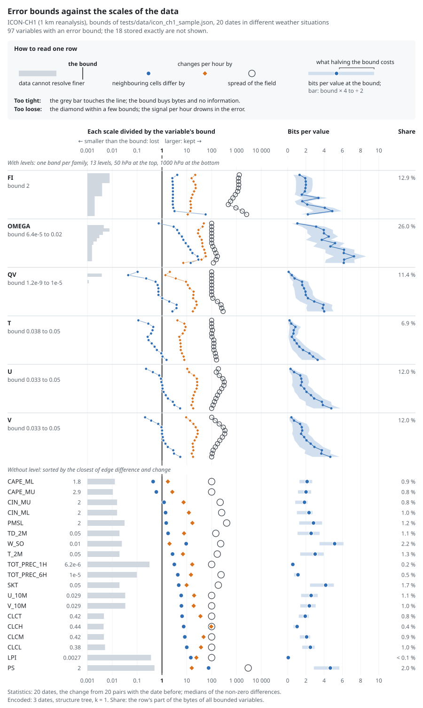

# User guide

How to install the package, write and read stores with its codecs, configure them, and what to do when something
fails. A store is written with the lattice codec alone or with the codec chain `[field_terms, static_ref,
icon_lattice_bytes]`, whose three configurations `anemoi-datasets-codecs physics expand` writes from one lattice codec
configuration; both are good choices ([Single codec or chain](#single-codec-or-chain)). How the codecs work:
[codecs/icon_lattice.md](codecs/icon_lattice.md), [codecs/static_ref.md](codecs/static_ref.md),
[codecs/field_terms.md](codecs/field_terms.md); architecture: [design.md](design.md).

Contents: [Install](#install) · [Quickstart](#quickstart) · [Configuration](#configuration) ·
[Choosing the bounds](#choosing-the-bounds) · [Physics layer](#physics-layer) ·
[Static fields, grids and sidecars](#static-fields-grids-and-sidecars) · [Codec chains](#codec-chains) ·
[Reading a store](#reading-a-store) · [Portability](#portability) · [Threads](#threads) ·
[Environment variables](#environment-variables) · [Command line](#command-line) · [Troubleshooting](#troubleshooting)

## Install

The package is not on PyPI and has no prebuilt wheels. It needs Python >= 3.11 and a C compiler with OpenMP (gcc):
the C kernels are compiled when the package is installed, as an AVX2 and a portable scalar variant, one of which is
picked when the library loads.

```bash
pip install "git+https://github.com/MeteoSwiss/anemoi-datasets-codecs"    # from GitHub
pip install ./anemoi-datasets-codecs                                     # or from a checkout
pip install "./anemoi-datasets-codecs[grid]"     # with scipy + netCDF4, for `grid build`
anemoi-datasets-codecs isa                       # the kernel variant in use
```

Runtime dependencies: numpy, zarr-python >= 3.1 and numcodecs >= 0.14 (Blosc, for the lossless fields and the
sidecar static files). The codecs are Zarr format 3 codecs only; there is no numcodecs codec and no Zarr format 2
support. Building anemoi datasets with them needs anemoi-datasets >= 0.5.50
([anemoi-datasets recipe](#anemoi-datasets-recipe-output)). A development setup is in
[contributing.md](contributing.md).

## Quickstart

### Encode a chunk

`LatticeCodec` is the codec engine: it encodes one chunk to bytes and back, independent of zarr. The examples use
the COSMO names of the ICON-CH1 datasets (the default `icon-ch1` convention); a dataset with other names needs a
matching [name convention](#physics-layer).

```python
import numpy as np
from anemoi_datasets_codecs.icon_lattice import LatticeCodec

codec = LatticeCodec(
    grid="icon-ch1",                                          # bundled lattice of ICON-CH1 (R19B08, 1147980 cells)
    variables=["T_2M", "PMSL", "FIS", "TOT_PREC_1H"],          # the chunk's variable order
    bounds={"T_2M": 0.05, "PMSL": 2.0, "TOT_PREC_.*": 1e-5},  # max abs error; names or regular expressions
    clip={"TOT_PREC_.*": [0, None]},
    static_fields=["FIS"],                                    # lossless and identical in every chunk
)
x = ...                                   # float32 (dates, variables, ensembles, cells), cells in grid order
enc = codec.encode(x)                     # bytes (container format v3)
y = codec.decode(enc).reshape(x.shape)    # |y - x| <= bound for every lossy variable; the others exact
```

Variables without a bound are stored exactly, except the forcings `cos_local_time`, `sin_local_time` and
`insolation`, which become analytic recipes (every cell within 1e-6): from the valid dates with
`codec.encode(x, dates=[...])` (numpy `datetime64` or ISO strings, one per date of the chunk), and without them,
as in every zarr write, recovered from the fields themselves (`physics.recipe_fit`, on by default;
[Physics layer](#physics-layer)).
`codec.decode(buf, out=...)` decodes into a preallocated float32 buffer. `codec.get_config()` returns the canonical
configuration (a small JSON dict), `LatticeCodec.from_config(cfg)` rebuilds the codec, and `codec.plan_report()` lists
the physics terms applied and dropped.

### Zarr 3 store

```python
import zarr
from anemoi_datasets_codecs.icon_lattice.zarr3 import IconLatticeCodec

cfg = codec.get_config()
g = zarr.open_group("out.zarr", mode="w", zarr_format=3)   # captured statics + lattice go to out.zarr/.codecs
a = g.create_array("data", shape=(n_dates, n_vars, 1, n_cells), chunks=(1, n_vars, 1, n_cells),
                   dtype="float32", serializer=IconLatticeCodec(**cfg), compressors=None)
a[:] = data
```

`icon_lattice` is an array-to-bytes codec: it replaces the default `bytes` serializer, hence `compressors=None`.
Chunks must hold whole dates: the last dimension is the cell count and the chunk's size a multiple of variables x
ensembles x cells. Where only the compressors can be chosen, use the bytes-to-bytes form after the default `bytes`
codec; the stored chunks are identical:

```python
from anemoi_datasets_codecs.icon_lattice.zarr3 import IconLatticeBytesCodec

g.create_array("data", shape=..., chunks=(1, n_vars, 1, n_cells), dtype="float32",
               compressors=[IconLatticeBytesCodec(**cfg)])
```

The configuration is stored in the array's `zarr.json` (a few KiB, [benchmarks.md](benchmarks.md#size)). Both codecs are
registered through the `zarr.codecs` entry point, so `zarr.open("out.zarr")` and anemoi-datasets find them without an
import. Encoding and decoding run in a worker thread (the C call releases the GIL), so zarr's concurrent chunk reads
decode in parallel.

### anemoi-datasets recipe (`output`)

Needs anemoi-datasets >= 0.5.50 with zarr-python >= 3.4.1, which anemoi-datasets installs on Python 3.12 and 3.13
([goals.md](goals.md#integration-with-anemoi-datasets)). The recipe's `output.format: zarr3` writes Zarr format 3 (an
experimental feature of anemoi-datasets), and `output.compressors` accepts bytes-to-bytes codecs only, hence
`icon_lattice_bytes` and the stages. Write the lattice codec configuration once (JSON or YAML: `grid`, `bounds`,
`clip`, `static_fields`, and optionally `structure`, `lossless`, `options`, `physics`; COSMO names of an ICON-CH1
dataset here):

```json
{"grid": "icon-ch1",
 "bounds": {"T_2M": 0.05, "PMSL": 2.0, "PS": 2.0, "T_[0-9]+": 0.05, "FI_[0-9]+": 2.0, "...": "..."},
 "clip": {"CLC.*": [0, 100]},
 "static_fields": ["FIS", "FR_LAND", "PLCOV", "SKC", "SOILTYP", "SSO_GAMMA", "SSO_SIGMA", "SSO_STDH", "SSO_THETA",
                   "cos_latitude", "cos_longitude", "sin_latitude", "sin_longitude"]}
```

and let `physics expand` write the recipe's `output` section for the dataset's variables:

```bash
anemoi-datasets-codecs physics expand lattice.json --variables source.zarr --forcing-bound 1e-6 --yaml  # a store
anemoi-datasets-codecs physics expand lattice.json --variables names.json --sort --forcing-bound 1e-6 --yaml  # a list
```

```yaml
output:
  format: zarr3
  chunking: {dates: 1, ensembles: 1, values: 1147980}   # the whole grid in one chunk
  compressors:
  - name: field_terms
    configuration: {variables: [CAPE_ML, ...], terms: {FI_1000: {sources: [FIS], intercept: true}, ...}, ...}
  - name: static_ref
    configuration: {variables: [CAPE_ML, ...], static_fields: [FIS, FR_LAND, ...], inline: false}
  - name: icon_lattice_bytes
    configuration: {version: 1, variables: [CAPE_ML, ...], bounds: {...}, static_fields: [], chain: true, ...}
```

Paste it into the recipe. The codecs are built when the recipe is parsed, from JSON only, so typos in variable names
fail there. `variables` must be the order in which anemoi writes them: anemoi sorts the variables by name (FI_100,
FI_1000, FI_150, ..., uppercase before lowercase), so give `--variables` an existing store of the same variables, or
the list with `--sort`. Without `chunking: values` anemoi splits a date larger than 32 MiB into grid chunks, which
the lattice codec refuses. The captured static fields and the lattice land in the dataset's
sidecar (`<output.zarr>/.codecs/`) as the `load` tasks write; readers need nothing but the package. After the build,
`anemoi-datasets-codecs check <output.zarr>` compares the variables with the store's and checks the chain.

The single codec instead (no chain: the static fields are references inside the lattice codec):

```yaml
output:
  format: zarr3
  chunking: {dates: 1, ensembles: 1, values: 1147980}
  compressors:
    - name: icon_lattice_bytes
      configuration:
        grid: icon-ch1
        variables: [CAPE_ML, CAPE_MU, ..., sin_longitude]   # exactly the dataset's variable order
        bounds: {T_2M: 0.05, PMSL: 2.0, PS: 2.0, "T_[0-9]+": 0.05, "FI_[0-9]+": 2.0}
        clip: {"CLC.*": [0, 100]}
        static_fields: [FIS, FR_LAND, PLCOV, SKC, SOILTYP, SSO_GAMMA, SSO_SIGMA, SSO_STDH, SSO_THETA,
                        cos_latitude, cos_longitude, sin_latitude, sin_longitude]
```

### Single codec or chain

Both are good ways to write a store. By default the single codec stores the forcings as recipes, and the chain gets
the same saving from a bound on the forcings (`physics expand --forcing-bound 1e-6`): on ICON-CH1 that chain was 0.2%
larger than the single codec on one date and 0.7% over three ([benchmarks.md](benchmarks.md#codec-chains)). Without
the forcing bound the chain stores the forcings exactly, about 6.5 MiB more per date. What differs:

| | single codec `icon_lattice_bytes` | chain `[field_terms, static_ref, icon_lattice_bytes]` |
|---|---|---|
| configuration | one | three that must agree (`physics expand` writes them, `check` verifies them) |
| zarr read of an ICON-CH1 date | 0.44 s on one thread, 0.13 s on 16 | 17-23% more on one thread, about 100 ms more on 16 |
| static fields | references inside the lattice codec's chunks | taken out by `static_ref`, which works ahead of any codec |
| exactness | every field without a bound is bit-exact, exact zeros of lossy fields kept; the forcings are recipes within 1e-6 by default (`physics.recipe_fit: false`: bit-exact) | the `field_terms` targets are within their bound, not bit-exact, and their exact zeros are not kept; the forcings are bit-exact, or within their bound with `--forcing-bound`; every other field as the single codec |
| forcing recipes | by default (`physics.recipe_fit`, or the valid dates with `encode(..., dates=...)`) | never (no latitude / longitude inputs); a bound on the forcings instead |
| other grids | ICON limited-area grids only | the stages carry over (`[static_ref, blosc]`); the lattice codec does not |
| measured on ICON-CH1 | size on 20 dates, decode speed on one date, a training-loader replica | size on a few dates, decode speed on one date, no loader replica |

Take the single codec for one configuration and the fastest decode; take the chain to keep the grid-agnostic work
(static fields, orography terms) out of the lattice codec, ahead of whatever codec ends the chain.

## Configuration

Small JSON, stored in `zarr.json` in its canonical form (`get_config()`): exact names, resolved bounds, the full grid
reference and every option and physics key, defaults included, so a store says exactly how it was written and later
versions code new chunks into it the same way ([compatibility promise](goals.md#compatibility-promise)); schema
`version` 1. The Zarr codecs add `written_by`, the package version that created the array, for example
`"anemoi-datasets-codecs 0.1.0"`: informational, ignored when the configuration is read and when configurations
are compared. A store keeps its stamp when a later version appends to it; a configuration copied with its stamp into
a new array keeps the old one too (drop the key to get the current version's). A key missing from a stored
configuration takes the reading version's default, so give a store written without `rounding` / `recipe_fit` these
keys before appending to it with a version whose defaults differ.

| key | default | meaning |
|---|---|---|
| `variables` | required | names in chunk order (or dicts `{name, max_error, clip}`) |
| `grid` | required | bundled alias (`icon-ch1`) or uuid, or `{name, uuid, n_cells, sha256}` (sha256 of the lattice) |
| `bounds` | `{}` | max abs error per variable: name or regex (full match; exact names first, then patterns in order) -> number, `null` / `"lossless"`, or `{max_error, clip}`; every key must match a variable |
| `clip` | `{}` | `[lo, hi]` per variable (names or regex; `null` for an open end), applied on decode |
| `static_fields` | `[]` | lossless variables identical in every chunk: stored as sha256 references |
| `n_ensembles` | 1 | ensemble axis of a chunk |
| `structure` | `tree` | prediction structure: `tree`, `tree_b` (smaller, slower to decode), `hc2_k3` (smallest, slower to decode; experimental) |
| `lossless` | blosc lz4 5 shuffle | numcodecs codec of the losslessly stored fields |
| `options` | see below | encoder settings |
| `physics` | on (`icon-ch1` convention) | the physics layer: on / off or a group of switches, see [Physics layer](#physics-layer) |
| `chain` | false | true: the codec follows field stages in a codec chain, see [Codec chains](#codec-chains) |

Options (`config.DEFAULT_OPTIONS`):

| option | default | meaning |
|---|---|---|
| `k` | 1 | quantisation step `2 bound / k`: maximum error `bound / k` |
| `recon_bits` | 3 | residual-domain reconstruction on the grid `step / 2^m` (ties to even); 0: the plain rule |
| `rounding` | `direct` | with `recon_bits` > 0: `direct` rounds the residual from the exact value (the full step the bound allows); `grid` rounds the value to the fine grid, then the residual (the step is `1 + 2^-m` smaller: on ICON-CH1 3% larger lossy fields, mean RMSE / bound 0.48 instead of 0.52, [benchmarks](benchmarks.md#configuration-choices)); the decoder is the same |
| `contexts` | 8 | context buckets per step (1..8; 1 = none) |
| `tables` | `auto` | entropy table layout: `auto` (smallest), `shared`, `per_step`, `none` |
| `table_penalty` | 256 | bytes charged per table in `auto` (the decode cost of building it) |
| `fit` | `ls` | per-step weights: robust least squares (`ls`) or the structure's defaults (`fixed`) |
| `statics` | `ref` | static fields: `ref` (sha256 references, arrays in sidecars), `inline` (every chunk carries them), `off` (lossless) |
| `rdoq` | false | also try k = 2 with encoder-chosen values inside the bound on predictable fields, keep the smaller |
| `max_depth` | 1 | the decoder's critical path: longest chain of fields decoded one after the other because of cross terms (`null`: unlimited) |
| `prob_bits` | `auto` | rANS precision 10 or 12 (`auto`: 10 only when it costs < 0.3%) |

The decoder needs none of the options: everything it needs is in the chunk, the lattice and the static fields. The
cross-term, below-ground and recipe settings are not options; they live in `physics` (an unknown option is an
error that names the physics key to use).

### Rounding and forcing recipes

Two defaults cost no decode time and decide much of the size. `options.rounding: direct` quantises with the full
step the bound allows (same decoder, same maximum error, mean RMSE 0.52 instead of 0.48 of the bound).
`physics.recipe_fit: true` stores the three forcings as recipes without a valid date, every cell within
`physics.recipe_bound` (1e-6) or stored exactly as a patch; in a chain, where the lattice codec has no latitude /
longitude, `physics expand --forcing-bound 1e-6` does that job. On ICON-CH1 the two together make a date of the
single codec 14.4-20.9% smaller than `rounding: grid` with the forcings stored exactly (17.6% on average over four
sample dates, [benchmarks](benchmarks.md#configuration-choices)).

For the other behaviour, set the keys: `"options": {"rounding": "grid"}` rounds the value to the fine grid first (a step
`1 + 2^-m` smaller, mean RMSE / bound 0.48, about 3% larger lossy fields), and `"physics": {"recipe_fit": false}` stores
the forcings bit for bit (16 bits per value, 11-18% of an ICON-CH1 chunk), for datasets whose users need the forcing
values exactly as they were written. `structure: hc2_k3` is another 10-12% smaller but decodes about 38% slower on one
thread, and `physics.below_ground: true` another 3-5% for about 25% more at 16 threads: both are experimental size
choices ([goals](goals.md#experimental)), for when size matters more than decode time.

## Choosing the bounds

Every bound is drawn as a vertical line, and the scales of its variable around it, each divided by the bound, so one
picture holds all variables. What lies left of the line is smaller than the bound and lost in the error: only the
data's own resolution belongs there. What lies right of it is kept: the differences between neighbouring cells and
the change from one hour to the next must sit well to the right, or the bound wipes them out.



*The bounds of `tests/data/icon_ch1_sample.json` on ICON-CH1 (1 km reanalysis): scales from the 20 dates of the
sample store and the hour before each (taken from the full dataset, since the sample's dates are relabelled), bits
per value from encoding 3 of these dates with all bounds times 4, 2, 1 and 1/2.*

* **Grey bar:** the finest step the data can resolve (float32 precision, or the step of the packing the data came
  with). A bar that touches the line means the bound is tighter than the data: it buys bytes and no information.
* **Blue disc:** how much neighbouring cells typically differ. Left of the line, the decoded field keeps structure
  over several cells but not from one cell to the next; fine for smooth fields.
* **Orange diamond:** how much the field typically changes per time step, which is what a forecast model learns. The
  error of a change between two decoded dates is up to twice the bound, so a diamond within a few bounds of the line
  means that signal drowns in the error: the bound is too loose.
* **Ring:** the spread (standard deviation) of the field. A bound set as a fixed fraction of it, 1% here, puts the
  ring at the same place (100) in every row.
* **Bits per value:** the dot is the cost at the bound; the light bar runs from 4 times the bound to half of it, so
  its part right of the dot is what halving the bound costs. **Share:** the row's part of the stored bytes.

Variables with levels (`<family>_<level>`) are one band each, top level first, with each scale a profile through the
levels. Typical values are medians over the cells that differ (mostly-zero fields such as precipitation would
otherwise show nothing).

Reading the example: the grey bar of `PS` reaches half its bound (the data are packed at 1 Pa, the bound is 2 Pa); the
diamonds of `QV` at the top levels, of `CAPE_*` and of `W_SO` lie only 1.4 to 3.6 bounds from the line, so their
hourly change is barely above the error; and `OMEGA` at levels 600 to 925 pays 6 to 7 bits per value with its
neighbour differences and hourly change 14 to 60 times its bound. The candidates for a tighter bound are cheap,
those for a looser one are where the bytes are.

The figure comes from `scripts/bounds_report.py` in a checkout of the repository. The scales are cheap to compute;
the encodes are not (one per date and scale, each a full encode of the date), so they are a separate step that writes
JSON, and the figure is redrawn from the JSON files:

```bash
python scripts/bounds_report.py stats  STORE CONFIG stats.json --dates 0:8760:730   # seconds per date
python scripts/bounds_report.py encode STORE CONFIG encode.json --dates 0,4380      # one encode per date and scale
python scripts/bounds_report.py draw stats.json bounds.svg --encode encode.json [--png bounds.png]
```

`CONFIG` is a configuration with its variables, as `anemoi-datasets-codecs plan` takes it (a JSON file or a store
written with the codec). The change per time step uses each date and the one before it when they are one time step (the
store's `frequency`) apart; give `--no-tendency` when the store's dates are not real. `--tolerances tol.json` adds a
mark for a tolerance known from elsewhere (`{name or regex: value}`, e.g. what observations resolve), `--table` writes
the numbers as CSV, `--png` needs cairosvg (not a dependency of the package).

## Physics layer

Everything that knows variable names or physics lives in `anemoi_datasets_codecs/physics/`; the lattice codec's core
(structures, quantiser, entropy coder, container, statics) and the stages are variable-agnostic. The layer resolves the
lattice codec's plan (cross terms target -> sources, below-ground mask terms, forcing recipes) and writes the stage
configurations of a chain (`physics expand`, [Codec chains](#codec-chains)). Three parts of the plan:

* **cross-variable terms**: a field is predicted from its own neighbours plus fixed-point multiples of the spatial
  detail of already decoded fields: surface terms (2 m temperature from orography and mean-sea-level pressure, surface
  pressure from mean-sea-level pressure and orography, 10 m wind from the lowest levels, ...), inter-level terms (odd
  levels of temperature, wind, humidity and vertical velocity from their two neighbours) and hydrostatic terms
  (geopotential from geopotential and temperature of nearby levels). The encoder fits the coefficients per chunk and
  drops a term where it does not pay;
* **below-ground terms** (off by default, experimental): on pressure levels, cells where the decoded surface pressure is
  below the level are predicted from the surface fields ICON extrapolates them from;
* **forcing recipes**: cos/sin_local_time and insolation are computed from the valid date and the static
  latitude / longitude fields instead of being stored (with `encode(..., dates=...)`, or through zarr with
  `recipe_fit`, below).

Measured sizes are in [benchmarks.md](benchmarks.md#physics-layer). Zarr never passes the valid date; stored
losslessly, the three forcings are 11-18% of an ICON-CH1 chunk. Two ways to code them without a date:

* **`recipe_fit: true`** (the default, single codec): without a date, the encoder recovers the recipe's coefficients
  from the field itself (a least-squares fit snapped to a whole second of the day, or a day of the year and an hour,
  then the coefficients of that date). Same payload, same guarantee as a dated recipe (every cell within `recipe_bound`
  or stored exactly; a field that is not the formula of any date falls back to lossless), 64 bytes per field. The fit
  snaps the local time to a whole second and the insolation to a whole hour of a day of the year: forcings of a valid
  time off the hour fall back to lossless. Not in a chain: the lattice codec there has no latitude / longitude.
  `recipe_fit: false` stores the forcings losslessly unless they have a bound.
* **a bound on the forcings**, e.g. `"bounds": {"cos_local_time": 1e-6, "sin_local_time": 1e-6, "insolation":
  1e-6}` (the recipes' own tolerance): the forcings are then lossy lattice fields, about 0.6 bits per value instead
  of 16, in the single codec and in a chain.

Switches (`physics`, all optional):

| key | default | meaning |
|---|---|---|
| `enabled` | true | `physics: off` (or `false`) turns the whole layer off |
| `convention` | `icon-ch1` | name convention: `icon-ch1`, `ifs`, or a dict (below) |
| `cross` | `shallow` | cross terms: `shallow` (decode DAG depth <= 4), `on` (deeper geopotential chain), `chain` (even levels also from the level two above), `off` |
| `surface_terms` | true | surface terms |
| `level_terms` | true | inter-level terms of T, U, V, QV, OMEGA |
| `hydrostatic` | true | geopotential (FI) terms |
| `below_ground` | false | below-ground terms (pressure levels only; experimental) |
| `forcings` | true | forcing recipes |
| `recipe_bound` | 1e-6 | max error of a recipe value before the cell is stored exactly |
| `recipe_fit` | true | without the valid date (zarr), recover a recipe's coefficients from the field; false: the forcings are stored exactly unless they have a bound |

**Name conventions.** A convention maps physical roles to variable names. The roles are named by keys (the COSMO names;
the table of roles is in [the codec documentation](codecs/icon_lattice.md#cross-variable-terms-and-the-plan)): surface
roles (`T_2M`, `PMSL`, `PS`, `FIS`, `SKT`, `TD_2M`, `U_10M`, `V_10M`, `CAPE_ML`, `CAPE_MU`, `CIN_ML`, `CIN_MU`,
`TOT_PREC_1H`, `TOT_PREC_6H`), level families (`T`, `U`, `V`, `QV`, `OMEGA`, `FI`) as a pattern with `{level}` plus the
ordered levels (**top of the atmosphere first, lowest last**), `vertical` (`pressure` / `model`), `pressure_scale`
(level value x scale = PS units), `star_level` (the geopotential level every upper level uses in `cross: shallow`; null:
none), and the forcing roles. Built in: `icon-ch1` (COSMO names as in the ICON-CH1 datasets, 13 pressure levels 50..1000
hPa) and `ifs` (anemoi ERA5 / IFS names: `2t`, `msl`, `sp`, `z`, `skt`, `2d`, `10u`, `10v`, `t_850`, `u_850`, `v_850`,
`q_850`, `w_850`, `z_850` on the same levels; experimental, tested on synthetic data only). A dict convention may
`extends` a built-in one and override any part (`null` removes a role). Roles a convention does not map, and variables
absent from the dataset, drop the terms that need them; nothing fails.

**What was applied.** `anemoi-datasets-codecs plan STORE_OR_JSON` (for a configuration without `variables`, such as
`lattice.json` above: `plan lattice.json --variables SRC`, a store or a list of names) prints every candidate term with
the sources applied and those dropped and why (absent, not in the convention, switched off, decode depth limit, more
than 4 sources, cycle with a below-ground term); `codec.plan_report()` returns the same. `anemoi-datasets-codecs info
CHUNK --config STORE -v` shows what a chunk actually uses (the encoder also drops terms that do not pay in that chunk).

Example: all off (core only: lattice prediction, quantiser, statics):

```python
LatticeCodec(grid="icon-ch1", variables=names, bounds=bounds, static_fields=statics, physics="off")
```

Example: a custom convention, model levels with lower-case names, surface fields with other names:

```python
LatticeCodec(
    grid="icon-ch1",
    variables=["t_ml_1", ..., "t_ml_60", "u_ml_1", ..., "t2m", "pmsl", "hsurf_geop", ...],
    bounds={"t_ml_.*": 0.1, "u_ml_.*": 0.2, "t2m": 0.05, "pmsl": 2.0},
    static_fields=["hsurf_geop"],
    physics={
        "convention": {
            "extends": "icon-ch1",
            "surface": {"T_2M": "t2m", "PMSL": "pmsl", "FIS": "hsurf_geop"},
            "families": {"T": "t_ml_{level}", "U": "u_ml_{level}", "V": "v_ml_{level}", "QV": None,
                         "OMEGA": None, "FI": None},
            "levels": list(range(1, 61)),      # model level 1 = top, 60 = lowest
            "vertical": "model",
        },
        "hydrostatic": False,
    },
)
```

`anemoi-datasets-codecs plan` on such a configuration shows the inter-level terms (`t_ml_2 <- t_ml_1, t_ml_3`, ...)
and the surface terms the mapping enables (`pmsl <- hsurf_geop`, `t2m <- hsurf_geop, pmsl`). The term layouts
themselves (which level uses which neighbours, the surface relations) are fixed in `physics/terms.py`; a new kind of
term is a new entry there (the core needs no change: it only sees target -> sources).

For experiments and tools the plan can be given directly, bypassing the physics layer (names are checked, the codec's
`max_depth` and 4-source limits still apply):

```python
from anemoi_datasets_codecs.plan import Plan

LatticeCodec(..., physics="off", plan=Plan(cross={"T_2M": ["PMSL", "FIS"]}))
```

A given plan is not part of the configuration: `get_config()` does not have it, so a store written with it decodes
normally but `LatticeCodec.from_config` of its metadata encodes with the physics plan of the configuration instead.

## Static fields, grids and sidecars

The configuration must stay small (a static field is a full array over the grid), and readers must never need the ICON
grid file. What a chunk only references therefore lives outside the configuration, content addressed by sha256, in
**sidecar** directories:

```
grids/<sha256>.npz           the lattice: position of every cell on the triangle lattice
statics/<sha256>.f4.blosc    a static field, float32, blosc zstd
```

* **Where sidecars are.** In a store as `<store>/.codecs/` (zarr ignores it; it is copied with the store directory), in
  the user cache (`$ANEMOI_DATASETS_CODECS_CACHE`, default `~/.cache/anemoi_datasets_codecs`), in any directory on
  `$ANEMOI_DATASETS_CODECS_PATH` (`:`-separated; a store root or a sidecar directory, e.g. one shared directory for all
  datasets on one grid), and, for lattices, inside the package (ICON-CH1). Search order: the sidecar of the store being
  read or written (zarr tells the codec pipeline which local store an array is in, so a store on a local filesystem
  needs no registration, [Reading a store](#reading-a-store)), stores registered in the process (`register_store`),
  `$ANEMOI_DATASETS_CODECS_PATH`, the cache, the package. Every file is checked against its sha256 when read.
* **Grids.** The configuration names the grid (`icon-ch1` expands to its uuid, cell count and lattice sha256). The
  reader loads the lattice by sha256 and builds the prediction structure from it (cached on disk in the cache
  directory); the chunk's structure sha catches any mismatch. The grid file is an encoder-side input only:
  `anemoi-datasets-codecs grid build GRID.nc --name NAME` recovers the lattice of a new grid from the cell centres and
  validates it against the file's neighbour table.
* **Statics.** The encoder computes the sha256 of each static field in each chunk. When that array is not available yet
  it is *captured*: written to the store target (the store being written, else the first registered store or writable
  `$ANEMOI_DATASETS_CODECS_PATH` entry) or, without one, to the cache. With a store target, every static a chunk
  references is placed in that store's sidecar, so the store is self-contained when the writer finishes.
  `anemoi-datasets-codecs attach STORE` copies whatever is still missing (from the cache or the path) into the store and
  verifies that a chunk decodes from the store alone.

Failure modes:

| situation | behaviour |
|---|---|
| encoder: a static field cannot be persisted anywhere (no store target, cache off or read-only) | that field is stored losslessly in that chunk (warning): a chunk never references data that may not exist |
| encoder: a "static" field changes between chunks | captured per value, up to 4 values per name and codec; beyond that, lossless (warning) |
| encoder: a lossy field cannot be coded within its bound | stored losslessly (warning); `info` shows fallback 1 |
| decoder: static field or lattice not on the search path | `MissingReference` (a `LookupError` and `ValueError`) naming the sha256 and the directories searched; never silent |
| decoder: chunk of another structure / grid | `ValueError` (structure sha mismatch) |
| sidecar file corrupt | `ValueError` (sha256 mismatch) |
| `statics: inline` | chunks are self-contained (every chunk carries its static fields) |

## Codec chains

A chain is a list of bytes-to-bytes codecs, `compressors=[field_terms, static_ref, icon_lattice_bytes]`: each field
stage rewrites the chunk's float32 field array and passes its per-chunk metadata on in an in-band envelope
([codecs/envelope.md](codecs/envelope.md)); the lattice codec, configured with `chain: true`, codes what the stages
leave. In encode order:

1. `field_terms` ([codecs/field_terms.md](codecs/field_terms.md)) replaces the targets of the exact-source terms
   (mean-sea-level and surface pressure, 2 m temperature and dew point, skin temperature and the lowest-level
   geopotential, each against the orography `FIS`) by residuals against a per-chunk fit;
2. `static_ref` ([codecs/static_ref.md](codecs/static_ref.md)) takes the static fields out of the chunk and
   references them in the sidecar;
3. `icon_lattice_bytes` codes the other fields, including the residuals, with its cross-variable terms between lossy
   fields.

The stages are grid-agnostic (`[static_ref, blosc]` works too) and the lattice codec keeps only what needs it; the
size per date is the single codec's within a fraction of a percent, the decode somewhat slower
([Single codec or chain](#single-codec-or-chain)).

### Writing the configurations: `physics expand`

The three configurations must agree (the lattice codec's `variables` are the fields that reach it; it codes each
`field_terms` target within the stage's `b_L = b (1 - margin)` and does not clip it; the stage's sources are exact
there), and nothing but their configurations ties them together. `physics expand` writes them from the dataset's
variables, the physics group and one lattice codec configuration:

```python
from anemoi_datasets_codecs import physics

entries = physics.expand(variables, lattice=lattice_config)  # [{name, configuration}, ...], encode order
physics.output_block(entries)                                # the recipe's output section (format, chunking, ...)
```

* `field_terms` gets the convention's exact-source terms for the targets that are present, have a bound and are not
  static, when the source (`FIS` by role) is a static field; their bounds and clips; and the margin: from the data range
  when the variables come from a store with statistics (`minimum`, `maximum`; the power of two at or above `4 ulp / b`
  of every target, at least `2^-10`), else `2^-6`. `--margin M` sets it (a power of two in `(0, 2^-4]`).
* `static_ref` gets the static fields present in the dataset (absent ones are dropped; `inline: true` with
  `options.statics: inline`).
* `icon_lattice_bytes` gets the other fields, their bounds and clips resolved per name with the stage targets at
  `b_L` and unclipped, `static_fields: []`, `chain: true`, and the physics group as given: without the static fields
  among its variables the lattice codec's default plan has no static source. One exception: `below_ground: true`
  becomes false there when the surface pressure is a `field_terms` target (the lattice codec sees its residual, so
  the below-ground mask would cover every cell; on four ICON-CH1 dates that made the chunk 14-20% larger). The
  below-ground terms are a single-codec feature.

* the forcings (`cos_local_time`, `sin_local_time`, `insolation` by role): stored losslessly in a chain (no dates,
  no latitude / longitude in the lattice codec), 11-18% of an ICON-CH1 chunk, unless they have a bound.
  `forcing_bound=1e-6` (`--forcing-bound 1e-6`, the recipes' own tolerance) gives every forcing without a bound of its
  own that bound; on four ICON-CH1 dates that takes 11-18% off the chunk. Where `expand` yields the single codec and
  `recipe_fit` is on (the default), the forcings its plan makes recipes do not get the bound (a lossy field is never a
  recipe); a forcing that cannot be a recipe there (its latitude / longitude inputs absent) does.

Bounds and clips are resolved as the lattice codec resolves them (`bounds` and `clip` over the variables, which may
be dicts `{name, max_error, clip}`). Without static fields to reference (none, or `options.statics: off`) the result
is the single lattice codec, with the physics group as given. The command (`anemoi-datasets-codecs physics expand
CONFIG`) takes the lattice configuration as a JSON / YAML file, a `{name, configuration}` entry or a store written with
the lattice codec, the variables with
`--variables` (an anemoi store, in its order, with its statistics for the margin; or a JSON / YAML list, in the
dataset's order, or with `--sort` in anemoi's; items `{param, levelist}` expand to `param_level` names and are sorted),
the physics group with `--physics` (`on`, `off`, `true`, `false`, a JSON object or a JSON / YAML file), and prints the
`output` section (`--compressors`: only the list; `--yaml`: YAML instead of JSON). It refuses an inconsistent
result.
`check`, `plan` and `info --config` read what it prints.

With zarr directly:

```python
import zarr
from anemoi_datasets_codecs import chain

codecs = [chain.codec_class(e["name"])(**e["configuration"]) for e in entries]
g = zarr.open_group("/path/to/out.zarr", mode="w")
a = g.create_array("data", shape=shape, chunks=(1, len(variables), 1, n_cells), dtype="float32", compressors=codecs)
a[:] = data
g.attrs["variables"] = list(variables)
```

### What changes with a chain

* **Readers**: nothing. A local store's sidecar is found through zarr, as for the single codec; with `inline: true` in
  `static_ref` the chunks carry the static fields.
* **Exactness of the stage targets.** A `field_terms` target decodes within its bound `b`, but not bit-exact even
  where the lattice codec stores its residual losslessly, and its exact zeros are not kept (zero-rich fields are no
  targets). Every other field behaves as with the single codec; static fields are exact.
* **Checks.** zarr and anemoi build each codec on its own, so a configuration that disagrees with another one is
  found by `anemoi-datasets-codecs check STORE` (or `check CHAIN.json` on the codec entries before a build): the store's
  variables against the first codec's, each stage's output against the next codec's variables, the lattice codec's
  bound and clip of every stage target, and the exactness of every stage source in the codecs after it. A wrong field
  count also fails at the first write.
* **Statics that cannot be referenced** (nowhere to capture them, or more than 4 different arrays for one name) are
  stored inline in the `static_ref` header with a warning, never passed on as a field.
* **Decode time.** The stages add 16-18% to a date's zarr read on one thread and about 100 ms on 16 on ICON-CH1,
  most of it `static_ref`'s write of the whole date ([benchmarks.md](benchmarks.md#codec-chains)).
* **Forcings** are never recipes in a chain: zarr passes no dates, and the lattice codec does not have the latitude /
  longitude inputs of the recipes (so `recipe_fit` does not apply either). They are stored losslessly unless they
  have a bound, which `physics expand --forcing-bound 1e-6` gives them.
* **Tools.** `attach`, `check` and `info` understand chained stores, including a generic compressor at the end
  (`[static_ref, blosc]`).

### The lattice codec in a chain (`chain: true`)

The lattice codec's `variables` are then the fields that reach it (the array's variables minus those the stages
drop, in the same order), not the array's: with `chain: true` the codec accepts a chunk grid with another field count
and checks the count chunk by chunk instead, so a wrong variable list fails at the first write, not when the array is
created. Without `chain` (the default) the codec rejects such a grid, and a stage ahead of it fails at the first
write with an error that names the key. `chain: true` on a codec used alone writes the same chunks as without it.
Stages are written against `anemoi_datasets_codecs.zarr3.FieldStage`
([design.md](design.md#field-stages-and-codec-chains)).

### Stages by hand

```python
from anemoi_datasets_codecs.field_terms import FieldTerms, FieldTermsCodec
from anemoi_datasets_codecs.icon_lattice.zarr3 import IconLatticeBytesCodec
from anemoi_datasets_codecs.static_ref.zarr3 import StaticRefCodec

stage = FieldTerms(
    variables=names,                                   # the array's variables, in chunk order
    terms={t: ["FIS"] for t in ("PMSL", "FI_1000", "T_2M", "PS", "SKT", "TD_2M")},
    bounds=bounds,                                     # the same bounds as the lattice configuration
    # clip={...}        clip of decoded targets (targets only)
    # margin=2**-6      the lattice codes a target within b_L = b (1 - margin)
    # intercept=True    per term: {"sources": [...], "intercept": False}
)
statics = StaticRefCodec(variables=names, static_fields=static_fields)
kept = [n for n in names if n not in static_fields]
lattice = IconLatticeBytesCodec(**{**lattice_config, "variables": kept, "static_fields": [], "chain": True,
                                   "bounds": {**bounds, **stage.lattice_bounds}})   # and no clip on the targets
zarr.create_array(store, ..., compressors=[FieldTermsCodec(**stage.get_config()), statics, lattice])
```

`field_terms` refuses targets without a bound and sources with a bound or that are its targets or forcing recipes;
`[field_terms, blosc]` gives every other field exactly and the targets within about one float32 ulp.

## Reading a store

The same for a chain and for the single codec: install the package and open the store.

```bash
python -c "import zarr; print(zarr.open_array('/path/to/out.zarr', path='data')[0].shape)"
python -c "from anemoi.datasets import open_dataset; print(open_dataset('/path/to/out.zarr')[0])"   # anemoi-datasets
anemoi-datasets-codecs check /path/to/out.zarr            # variables, chain, sidecar complete, decodes from the store
```

How the codecs find the sidecar: zarr hands the store of every array to its *codec pipeline*, and the package's
pipeline (`anemoi_datasets_codecs.zarr3.SidecarPipeline`, zarr's default pipeline plus the store, selected through
zarr's `codec_pipeline.path` setting when the codecs are imported) serves `<store>/.codecs/` to the codecs while the
array is read or written. A sidecar elsewhere (one shared directory for all datasets on a grid, a store copied without
its sidecar) is given with `ANEMOI_DATASETS_CODECS_PATH` or `register_store(path)` in the reading process. The package
leaves another configured pipeline alone, and `ANEMOI_DATASETS_CODECS_PIPELINE=off` turns its own off; the sidecar must
then be given this way. The codecs are found through zarr's `zarr.codecs` entry points; they pickle as their
configurations (DataLoader workers started with `spawn`).

## Portability

A store is self-contained once its sidecar is complete: the chunks, the small codec configuration in `zarr.json` and
`<store>/.codecs/` (the lattice and the static fields) are all the decoder needs. No grid file, cache or
site-specific path is involved. To move a store:

1. Copy the whole store directory *including the hidden sidecar* (`rsync -a`, `cp -a`). `anemoi-datasets copy`
   does not copy `.codecs` (it is not a zarr node): run `anemoi-datasets-codecs attach` on the copy afterwards
   with the original reachable, or copy the sidecar by hand. Sidecar lookup is local-filesystem only; an object
   store needs the sidecar on a local path given through `ANEMOI_DATASETS_CODECS_PATH`.
2. On the target machine, install the package (from source: a C compiler and OpenMP are needed) and open the store;
   `anemoi-datasets-codecs check /new/path/to/out.zarr` verifies that every chunk decodes from the store's own sidecar.

Speed on the target machine depends on its CPU: x86-64 with AVX2
runs the measured decoder; without AVX2 the scalar fallback is several times slower
([benchmarks.md](benchmarks.md#decode-speed)); aarch64 has not been built or tested.

## Threads

`ANEMOI_DATASETS_CODECS_THREADS` (read at every call) sets the threads of a chunk decode (OpenMP) and of the encoder's
field pool. Default: **1 inside a torch DataLoader worker** (detected with `torch.utils.data.get_worker_info()`,
only when torch is already imported) and `min(16, CPUs available to the process)` otherwise. A loader already runs
one process per worker; 16 decoder threads per worker oversubscribe a training node for no gain. Zarr decodes chunks
in worker threads, so concurrent chunk reads also run in parallel.

**Fork.** GNU OpenMP's thread pool does not survive `fork()`: a process forked after its parent decoded with several
threads decodes with 1 thread whatever the setting (one `RuntimeWarning`); without this clamp a multi-threaded decode
in such a child hangs (`scripts/fork_check.py`). Use the `spawn` or `forkserver` start method for workers that should
decode with several threads.

## Environment variables

| variable | default | meaning |
|---|---|---|
| `ANEMOI_DATASETS_CODECS_THREADS` | 1 in DataLoader workers, else min(16, CPUs) | codec threads |
| `ANEMOI_DATASETS_CODECS_PATH` | | sidecars elsewhere than in the store being read or written (stores or sidecar directories, `:`-separated); the first writable entry is the encoder's store target when no local store is being written |
| `ANEMOI_DATASETS_CODECS_PIPELINE` | on | `off`: do not select the package's codec pipeline, which serves a local store's sidecar to the codecs ([Reading a store](#reading-a-store)) |
| `ANEMOI_DATASETS_CODECS_CACHE` | `~/.cache/anemoi_datasets_codecs` | structures, captured statics, built lattices; `off` disables it |
| `ANEMOI_DATASETS_CODECS_ISA` | `auto` | kernel variant: `auto`, `avx2`, `scalar` |
| `ANEMOI_DATASETS_CODECS_LIBRARY` | | another build of the compiled kernels (development) |

## Command line

```
anemoi-datasets-codecs isa                    kernel variants (avx2 / scalar) and the one in use
anemoi-datasets-codecs grids                  grids bundled with the package
anemoi-datasets-codecs grid build GRID.nc [--name N] [--out DIR] [--no-check]
                                              lattice file of an ICON grid (encoder side; extra "grid")
anemoi-datasets-codecs attach STORE [--array data] [--sample N]
                                              copy the lattice and static fields into STORE/.codecs
anemoi-datasets-codecs check STORE_OR_JSON [--array data] [--sample N]
                                              variables vs the store's attribute, chain consistency, sidecar
                                              complete, decodes, the writer stamps; a JSON chain: the
                                              configurations only
anemoi-datasets-codecs info CHUNK_FILE [--config STORE_OR_JSON] [-v]
                                              field table of one chunk (-v: per field, the terms it uses); for a
                                              chained chunk its envelope and stage headers first; with --config,
                                              the configuration's writer stamp
anemoi-datasets-codecs plan STORE_OR_JSON [--variables SRC] [--sort] [--json]
                                              the lattice codec's physics plan: terms applied / dropped, why
anemoi-datasets-codecs physics expand CONFIG [--variables SRC] [--sort] [--physics P] [--margin M]
                                              [--forcing-bound B] [--compressors] [--yaml]
                                              the chain of a lattice configuration, as a recipe's output section
anemoi-datasets-codecs lab ...                the research toolkit (lab.md; experimental)
```

Errors are reported as one line, `anemoi-datasets-codecs <command>: <message>`, with exit status 1;
`anemoi-datasets-codecs --debug <command> ...` shows the traceback instead. `attach` scans all chunks by default,
`check` the first 4 (`--sample N`; `--sample 0`: all). `check`, `plan` and
`info --config` take a store, a JSON (or YAML) configuration, a `{name, configuration}` codec entry, a list of them (a
chain), `{compressors: [...]}` or a recipe / `physics expand` output `{output: {compressors: [...]}}`.

## Troubleshooting

| symptom | cause | fix |
|---|---|---|
| `MissingReference: static field <sha> ... searched: ...` on the first read | the store's sidecar is incomplete (copied without `.codecs/`, or the writer could not capture into it), the store is not a local directory, or another zarr codec pipeline is configured | `anemoi-datasets-codecs check <store>`; `attach` with the writer's cache or path reachable; else `export ANEMOI_DATASETS_CODECS_PATH=<store>` or `register_store(<store>)` |
| `MissingReference: lattice <sha> ...` | a grid that is not bundled, and no sidecar with its lattice on the path | as above; `grid build` the lattice on the writing side |
| `chunk was written with a different structure (sha mismatch)` | the configuration's `structure` or `grid` differs from the one the chunk was written with, or a structure builder changed | read with the configuration stored with the array; never edit `structure` / `grid` of an existing array |
| `lattice codec chunk header has N fields ..., the chunk holds M values: a corrupt chunk or another array's` | a corrupt or truncated chunk file, or a chunk copied from another array | copy the store again; `anemoi-datasets-codecs check <store> --sample 0` decodes every chunk |
| `sha256 mismatch` reading a sidecar file | corrupt or truncated copy | copy the file again (`attach`) |
| `chunks ... must hold whole dates of (variables, ensembles, cells)` when creating an array | chunk shape split across variables or cells | chunks `(n_dates_per_chunk, n_variables, n_ensembles, n_cells)` |
| `chunk of N values is not a multiple of (variables, ensembles, cells)` on encode | the data does not match `variables` / `n_ensembles` / the grid's cell count | check the variable list and the grid |
| `... needs float32 data` | the array is not float32 | create the array with `dtype="float32"` |
| `bounds keys match no variable` / `unknown lattice codec options` at recipe parse time | a typo, or a physics setting given as an option | fix the key; `cross`, `below_ground`, `forcings`, `recipe_bound` go in `physics` |
| `check`: variables differ from the store's attribute | the recipe's `variables` are not in anemoi's order | regenerate the configurations with `physics expand --variables <store>` (or `--sort`) |
| `check`: a stage target coded above `b_L`, clipped, or a source not exact | the chain's configurations were written by hand and disagree | regenerate them with `physics expand` |
| `chunks ... must hold whole dates` from an anemoi build | the recipe has no `chunking: values` and anemoi split the grid | `chunking: {dates: 1, ensembles: 1, values: <n_cells>}` (`physics expand` writes it) |
| warning `static field ... stored losslessly` while writing | the store is not a writable local directory and the cache is off | `ANEMOI_DATASETS_CODECS_PATH=<dir>` for the writer, then `attach` on the store |
| decode hangs in a forked worker | should not happen (clamped to 1 thread with a `RuntimeWarning`) | use `spawn` / `forkserver` workers to decode with several threads |
| slow decode on a machine without AVX2 | the scalar variant (several times slower) | `anemoi-datasets-codecs isa` shows the variant in use |
